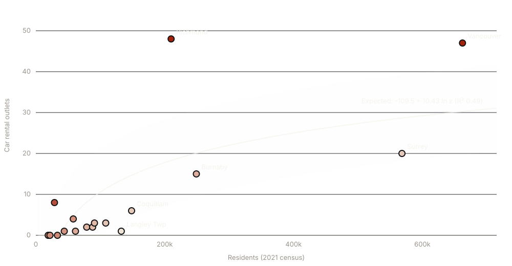
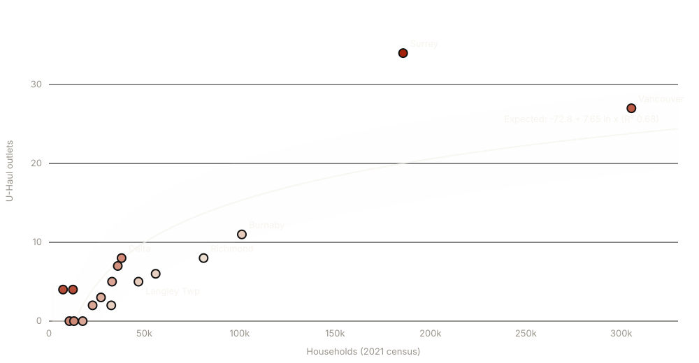

# Ember Rent business plan

Car, van and truck rental for Surrey, BC, south of the Fraser in Metro Vancouver.

## 1. Executive summary

**The answer: launch Ember Rent as a single Surrey location renting cargo vans, pickups and light trucks to trade and logistics businesses, with a smaller car fleet for residents. Stay away from the airport and downtown. Expand to Langley Township, then the Tri-Cities, only once the Surrey unit economics are proven.**

Why this is the right first move:

1. **Surrey is the largest supply gap in Metro Vancouver.** It holds 21.6% of Metro population (568,322 people) but has 0.35 car rental locations per 10,000 residents, against a Metro average of 0.61 ([GAP_ANALYSIS](../market/GAP_ANALYSIS.md)).
2. **The truck gap is commercial.** 127 of 149 counted truck rental locations in Metro Vancouver are U-Haul, a consumer moving brand. Penske has 6 and Ryder 1. Surrey alone has 1,418 trucking businesses with employees, 57.9% of the Metro total, and 4,648 construction businesses ([GAP_ANALYSIS](../market/GAP_ANALYSIS.md), [municipalities.csv](../market/municipalities.csv)). The service area holds 3,295 mapped industrial buildings, 1,616 of them in Surrey ([service-area.json](../site/public/service-area.json)).
3. **The market is large relative to any plausible fleet.** Metro Vancouver's share of BC automotive rental and leasing revenue is C$647 to 698 million a year. A new operator's year 1 to 3 revenue on placeholder inputs is C$0.2 to 3.2 million, under 0.5% of that ([TAM_SAM_SOM](../market/TAM_SAM_SOM.md)). Growth is limited by capital and utilisation, not by demand.
4. **Surrey is short of exactly what Ember Rent rents.** Against logarithmic curves fitted across Metro, Surrey has 20 car outlets where 28.7 are expected and 0.49 commercial truck and van outlets per 1,000 trade businesses against 1.32 Metro wide, while its truck supply is 34 of 37 U-Haul (section 4.1).
5. **The airport is the wrong fight.** 18 counted car rental locations sit within 3 km of YVR, almost all majors ([GAP_ANALYSIS](../market/GAP_ANALYSIS.md)).

What could sink it: under-utilised vehicles financed with debt, rates set without a full survey (only U-Haul and Home Depot publish Surrey prices, section 4.2), insurance cost and availability for a small U-Drive fleet, and the closed ICBC replacement-rental channel (ICBC's preferred suppliers are Budget and Enterprise from 1 September 2026, per [MARKETING_REVIEW](../brand/MARKETING_REVIEW.md)). Section 6 states these plainly.

Operations are planned AI-first: several frontier models watch bookings, prices, telematics and road data continuously, and a small crew does the handovers, driving and cleaning and approves every charge, refund and purchase (section 17). The compliance framework, startup costs and SWOT are in sections 14 to 16.

Decisions before launch: fleet size and mix, capital and financing (Ford Credit excludes rental units from commercial purchase financing, section 11.6), site, insurance carrier, legal entity. Turo is both a price competitor and a channel for idle winter days, and owner-sourced vehicles are a phase 2 option for summer capacity, viable only on vehicles grossing about C$1,473 a month or more (sections 4.3, 4.4).

## 2. Business strategy

### 2.1 Positioning

Ember Rent is a local, design-led rental brand for jobs that car share and the airport majors serve badly: a van for a day's work, a pickup for a half-day haul, a weekly car while your own is in the shop. Its promise is a clear all-in price and a fast handover ([MARKETING_REVIEW](../brand/MARKETING_REVIEW.md)).

The marketing review found that the majors segment by price tier and by airport versus neighbourhood, car share by trip length and U-Haul by moving job, and that nobody positions on a fast, transparent handover for mixed cars, vans and trucks in the neighbourhoods. The gap is qualitative, not measured ([MARKETING_REVIEW](../brand/MARKETING_REVIEW.md)).

### 2.2 Target segments

| Priority | Segment | Evidence | Status |
|---|---|---|---|
| 1 | Trades, contractors and small logistics firms needing vans and pickups on account | Surrey 1,418 trucking (NAICS 484) and 4,648 construction (NAICS 23) businesses. South of Fraser holds 76.4% of Metro trucking businesses ([GAP_ANALYSIS](../market/GAP_ANALYSIS.md)) | Supported by data |
| 2 | Residents renting cars for the day, weekend or week | Surrey 0.35 car rental locations per 10,000 residents, Langley Township 0.08, Delta 0.28 ([GAP_ANALYSIS](../market/GAP_ANALYSIS.md)) | Supported by data |
| 3 | Moving and hourly-job renters | Autocomplete shows "cargo van rental", "moving van rental" and "home depot van rental" intent ([MARKETING_REVIEW](../brand/MARKETING_REVIEW.md)) | Qualitative only, no search volumes |
| 4 | Private-repair replacement (non-ICBC), film and event production, property managers | Named as open B2B channels in [MARKETING_REVIEW](../brand/MARKETING_REVIEW.md) | Hypothesis to test |
| Not targeted at launch | Airport and cruise visitors | 18 rental locations within 3 km of YVR and 39 within 3 km of the cruise terminal ([GAP_ANALYSIS](../market/GAP_ANALYSIS.md)) | Saturated |

One-way, long-term, EV and gig-driver demand could not be assessed from any source ([GAP_ANALYSIS](../market/GAP_ANALYSIS.md)). They are interview questions, not segments.

### 2.3 Value proposition

| For | Ember Rent offers | Versus |
|---|---|---|
| Trade accounts | Vans and pickups by the hour, half-day, day and month, monthly invoicing, named-driver lists | U-Haul's consumer moving model, Penske and Ryder's thin local presence |
| Residents | Weekly and weekend cars close to home, all-in price, quick handover | Majors concentrated in Vancouver and Richmond |
| Everyone | One price that includes every mandatory fee except government charges | Drip pricing, which is unlawful in Canada and has been penalised in car rental (section 7) |

Not yet set: rate cards, deposit, mileage policy, age rules, delivery.

### 2.4 Phased launch

| Phase | Where | What | Gate to the next phase |
|---|---|---|---|
| 1 | Surrey, near industrial and trucking employment | Vans, pickups, light trucks and a smaller car fleet | Fleet utilisation and revenue per day at or above break-even (section 11), sustained |
| 2 | Langley Township, same south of Fraser corridor | Same mix | 1 counted car rental location for 132,603 residents, 222 trucking and 1,036 construction businesses ([GAP_ANALYSIS](../market/GAP_ANALYSIS.md)) |
| 3 | Tri-Cities, near Burquitlam or Coquitlam Central | Resident car rental | Northeast sector at 0.28 car rental locations per 10,000. Burquitlam is one of three stations with no counted rental within 2 km ([GAP_ANALYSIS](../market/GAP_ANALYSIS.md)) |
| Avoid at launch | YVR, Richmond airport district, downtown, cruise terminal | | Densest concentration of majors |

Langley City is over-supplied (4.14 rental locations per 10,000, an auto-mall cluster), so phase 2 should sit in the Township away from it ([GAP_ANALYSIS](../market/GAP_ANALYSIS.md)).

## 3. Market sizing

All figures are from [TAM_SAM_SOM](../market/TAM_SAM_SOM.md) and [tam_sam_som.json](../market/tam_sam_som.json), in Canadian dollars.

| Level | Value | Method |
|---|---:|---|
| TAM, Canada | C$10,697.9 million (2024, preliminary) | StatCan table 21-10-0012, NAICS 5321 automotive equipment rental and leasing operating revenue |
| TAM, British Columbia | C$1,320.2 million (2024, preliminary) | Same table. BC grew from C$868.1 million in 2020 |
| SAM, Metro Vancouver | C$646.9 to 697.7 million | BC revenue allocated by four drivers: tourism spending 49.0%, households 51.1%, NAICS 5321 business locations 52.0%, population 52.8% |
| SAM, consumer slice only | C$252.3 to 272.1 million | SAM × 39.0%, the Canadian share of sales to individuals and households |
| SOM, years 1 to 3 | C$0.2 to 3.2 million | Bottom-up: fleet × 365 × utilisation × average daily rate, on placeholder inputs |

Operating profit margin in 2024 was 10.7% in BC and 13.0% in Canada, down from 16.8% and 17.6% in 2023. Businesses bought 57.3% of national sales, which supports a B2B-led plan ([TAM_SAM_SOM](../market/TAM_SAM_SOM.md)).

**SOM scenarios, reproduced exactly from [TAM_SAM_SOM](../market/TAM_SAM_SOM.md).** Inputs are in [som_inputs.json](../tools/market/som_inputs.json). Every fleet figure, every daily rate and the low and base utilisation are placeholders, not facts. The high-case 81% utilisation is Hertz's company-wide full-year 2025 figure.

| Scenario | Year | Fleet | Revenue (C$) | Share of SAM |
|---|---:|---:|---:|---|
| Low (60%, C$60) | 1 | 15 | 197,100 | 0.028% to 0.030% |
| Low | 2 | 25 | 328,500 | 0.047% to 0.051% |
| Low | 3 | 35 | 459,900 | 0.066% to 0.071% |
| Base (70%, C$75) | 1 | 25 | 479,062 | 0.069% to 0.074% |
| Base | 2 | 45 | 862,312 | 0.124% to 0.133% |
| Base | 3 | 70 | 1,341,375 | 0.192% to 0.207% |
| High (81%, C$90) | 1 | 40 | 1,064,340 | 0.153% to 0.165% |
| High | 2 | 80 | 2,128,680 | 0.305% to 0.329% |
| High | 3 | 120 | 3,193,020 | 0.458% to 0.494% |

**Limits.** The TAM includes passenger car leasing and RV rental, which no published table separates. 2024 is preliminary. The allocation drivers are proxies. No Metro Vancouver daily rate or utilisation figure was found. The SOM is a capacity calculation that ignores competitor response, seasonality and ramp-up ([TAM_SAM_SOM](../market/TAM_SAM_SOM.md)).

## 4. Competitive analysis

Counted rental locations (`counted = true`) in the Ember Rent service area (Surrey, Delta, White Rock, Langley City, Langley Township) were tallied for this plan from [supply.geojson](../market/supply.geojson). Metro totals are from [GAP_ANALYSIS](../market/GAP_ANALYSIS.md). Locations are storefronts, not fleet: a two-truck U-Haul dealer and a busy airport counter each count once.

| Competitor | Metro locations | Service area | Surrey | Positioning | Ember Rent angle |
|---|---:|---:|---:|---|---|
| U-Haul | 127 | 51 | 34 | "No. 1 choice of do-it-yourself movers" ([MARKETING_REVIEW](../brand/MARKETING_REVIEW.md)) | Compete on in-town hourly and half-day van and pickup jobs, vehicle quality and trade accounts, not one-way moves |
| Enterprise | 23 | 6 | 3 | Neighbourhood network and body-shop replacement. ICBC preferred supplier from 1 September 2026 | Do not chase ICBC replacement. Compete on speed, trade vans and private-repair customers |
| Hertz (with Dollar, Thrifty) | 22 (Dollar 3, Thrifty 5) | 6 (Dollar 1, Thrifty 1) | 4 (Dollar 1, Thrifty 1) | Three-tier ladder, premium to deep value | One brand with a good, better, best fleet ladder |
| Alamo, National | 24, 7 | 4, 1 | 3, 1 | Enterprise group car brands, leisure and corporate | Residents' weekly and weekend cars, all-in price |
| Avis, Budget | 12, 10 | 3, 1 | 2, 1 | Avis above value brands, Budget value-conscious. Budget is an ICBC preferred supplier | Same as Enterprise |
| Penske | 6 | 2 | 1 | Commercial truck | Closest direct rival for trade trucks. Ember Rent adds vans, pickups and cars in one place |
| Ryder | 1 | 1 (Delta) | 0 | Commercial truck | Same |
| Sixt | 3 | 0 | 0 | Premium fleet, downtown Vancouver since 2022 | Premium in experience, not in fleet price |
| Discount Car and Truck Rentals | 6 | 1 | 1 | Independent car and truck | Direct like-for-like rival. Benchmark its rates |
| Routes | 2 | 1 | 1 | Independent car | Shows independents appear in local search |
| Independents and unbranded | 59 | 15 | 4 | Mixed | Win on reviews, price clarity and handover |
| Evo, Modo, Zipcar, Car2Go (carshare) | 6 points | 0 | 0 | Trips of a few hours, Vancouver and Burnaby. Evo about 2,300 and Modo 1,000 vehicles in August 2023. Since 20 July 2026 Evo has one-way zones at Surrey Central and Guildford, and Modo lists Surrey, with pickups and cargo vans. Zipcar left BC in 2020 and Car2Go in 2020 | Target the day, week and the jobs car share cannot do. See the car sharing and rental tab |
| Turo (peer to peer) | not counted | not counted | not counted | Marketplace with ICBC blanket insurance for BC hosts. Median Canadian host earning C$657 a month, January to October 2025 | Competitor on price and a channel for idle days. See section 4.3 |

Positioning and carshare figures are from [MARKETING_REVIEW](../brand/MARKETING_REVIEW.md) and [GAP_ANALYSIS](../market/GAP_ANALYSIS.md). The carshare counts are from those records and do not include Evo's and Modo's Surrey locations. The 2026 carshare position, comparable businesses, roadmaps and the rental operations checklist are in the [car sharing and rental tab](RENTAL_PLAN.md). Zipcar and Car2Go records may be stale. Turo listing counts were not sourced. The majors' local rates are unknown, and a rate survey is the first open item in section 13.

### 4.1 Where competition is thin

Each municipality's rental supply is measured against a logarithmic curve fitted across Metro Vancouver: the number of outlets a place of that size usually has. Supply is split by what it rents out, because a U-Haul dealer and a commercial van counter serve different customers. Above the curve is competitive (deep blood orange), below it is underserved (bone white). Method, fits and per-municipality scores: [competition.json](../market/competition.json), built by [competition.py](../tools/market/competition.py) from [municipalities.csv](../market/municipalities.csv) and [supply.geojson](../market/supply.geojson).

The index is the mean of three scores, each the distance from its curve in units of the curve's error, clipped to ±2. Hover a municipality or an outlet for its numbers. The same polygons load into [SlipCurve GIS](https://gostrogis.github.io/SLIPCURVE/modules/module-gis.html) from [competition.geojson](../market/competition.geojson).

**Cars: short everywhere outside Vancouver and Richmond.** Expected car outlets = −109.5 + 10.43 ln(residents), R² 0.49 over 17 municipalities.

| Municipality | Car outlets | Curve expects |
|---|---:|---:|
| Richmond | 48 | 18.3 |
| Vancouver | 47 | 30.3 |
| Surrey | 20 | 28.7 |
| Coquitlam | 6 | 14.7 |
| Langley Township | 1 | 13.5 |
| Delta | 3 | 11.4 |
| Maple Ridge | 3 | 9.6 |
| North Vancouver District | 2 | 9.2 |
| New Westminster | 2 | 8.1 |

**Consumer moving: saturated by one brand.** Expected U-Haul outlets = −72.8 + 7.65 ln(households), R² 0.68. U-Haul is 127 of 149 truck rental outlets in Metro. Surrey has 34 against 20.0 expected, the most over-supplied place on any of the three curves.

**Commercial trucks and vans: thin everywhere, thinnest per business in Surrey.** Expected outlets = −5.9 + 1.16 ln(trucking, construction and warehousing businesses), R² 0.64. Metro has 22 commercial truck and van outlets for 16,631 such businesses, 1.32 per 1,000. Surrey has 3 for 6,125, 0.49 per 1,000, against Vancouver 1.71, Delta 3.06 and Langley Township 3.92. The curve flattens with size, so on the curve Surrey reads 3 against 4.2 expected: close to it, but the largest base of trade customers in Metro.

**What each place rents out.** Grey is U-Haul, orange is commercial truck and van.

| Municipality | Index | Notable gaps |
|---|---:|---|
| North Vancouver District | −0.97 | No commercial truck or van rental. 2 car outlets against 9.2 expected |
| Coquitlam | −0.82 | 6 of 7 truck outlets are U-Haul. No car share. Burquitlam Station has no rental within 2 km |
| Maple Ridge | −0.51 | 5 of 6 truck outlets are U-Haul |
| New Westminster | −0.47 | All 7 truck outlets are U-Haul. No commercial truck or van rental |
| North Vancouver City | −0.39 | All 3 truck outlets are U-Haul |
| Port Coquitlam | −0.33 | 1 car outlet against 5.5 expected |
| West Vancouver | −0.23 | No truck or van rental |
| Burnaby | −0.21 | Production Way-University Station has no rental within 2 km |
| Richmond | −0.10 | Car supply 48 against 18.3, truck supply 8 of 9 U-Haul. No car share |
| Surrey | −0.02 | 34 of 37 truck outlets are U-Haul. 0.49 commercial outlets per 1,000 trade businesses. No car share |
| Langley Township | −0.02 | 1 car outlet against 13.5 expected. No car share |
| Port Moody | 0.00 | No car or truck rental |
| White Rock | 0.00 | No car or truck rental |
| Delta | +0.07 | No car share |
| Pitt Meadows | +0.26 | No car rental. All 4 truck outlets are U-Haul |
| Langley City | +0.50 | Auto-mall cluster. All 4 truck outlets are U-Haul |
| Vancouver | +1.06 | 27 of 31 truck outlets are U-Haul |

**What this means for the launch.** Surrey's index is neutral because a surplus of U-Haul dealers offsets a shortage of cars and commercial vehicles. Ember Rent's fleet is cars, vans and pickups for trade, the two kinds Surrey is short of, and nothing that competes with U-Haul's one-way moves. The deepest bone-white areas, North Vancouver District and Coquitlam, are resident car markets with little trade base. They suit the phase 3 Tri-Cities car location, not a trade fleet. The index counts outlets, not vehicles, and treats a two-truck dealer the same as a large depot.

### 4.2 Published rates

Retrieved 23 November 2026. Before tax.

Sources: [U-Haul](https://www.uhaul.com/Truck-Rentals/) Surrey in-town quote for a 3 December 2026 pickup. [Home Depot](https://www.homedepot.ca/en/home/tool-and-vehicle-rental.html) national page, Surrey store not confirmed. [DOZR](https://dozr.com/rent/truck/cargo-van/Surrey-BC) listing from an unnamed Surrey supplier.

| Operator | Vehicle | Rate | Kilometres |
|---|---|---:|---|
| U-Haul | Cargo van | C$19.95 per rental | C$0.99/km |
| U-Haul | 10 ft truck | C$19.95 per rental | C$1.09/km |
| U-Haul | 15 ft truck | C$29.95 per rental | C$1.09/km |
| Home Depot | Small cargo van, pickup | C$24.95 first 90 min, C$79.95 4 h, C$119.95/day | Unlimited |
| Home Depot | Large cargo van | C$39.00 first 90 min, C$94.00 4 h, C$139.95/day | Unlimited |
| DOZR | Cargo van | C$126/day, C$756/week, C$3,024/4 weeks | Not stated |

U-Haul adds a C$1.00 environmental fee per rental.

Enterprise, Budget, Penske and Discount publish no Surrey rates outside their booking engines. KAYAK shows user-found Surrey car rates of C$24 to C$33 a day for small and midsize cars, and C$53 to C$92 for pickups, over the last 12 months ([KAYAK](https://www.ca.kayak.com/Surrey-Pickup-Truck-Rentals.6168.cpk.ksp)). These are historical searches, not quotes.

| Policy | Enterprise Surrey | Home Depot Canada |
|---|---|---|
| Minimum age | 21 | 21 |
| Under 25 | C$20/day, vans and pickups up to ¾ ton only | |
| Deposit | C$300 (non-commercial renters) | C$500 |
| Damage waiver | C$9.99 to 52.99/day, trucks. C$32.99 to 79.99/day, cars | Not sold. Renter must carry non-owned auto liability |
| Source | [Truck](https://www.enterprise.com/en/car-rental-locations/ca/bc/surrey-truck-rental-c45t.html), [cars](https://www.enterprise.com/en/car-rental-locations/ca/bc/surrey-newton-c402.html) | [Home Depot](https://www.homedepot.ca/en/home/tool-and-vehicle-rental.html) |

**Where Ember Rent sits.** U-Haul and Home Depot lead with short-hire prices under C$25. Ember Rent's all-in daily price competes against Home Depot's C$119.95 to C$139.95 day rate with unlimited kilometres and against Enterprise's day rate plus its waiver, not against U-Haul's per-rental headline.

### 4.3 Rent-by-owner

Rent-by-owner is the Airbnb model for vehicles: private owners list their own cars, vans and trucks on a platform, which takes a share and supplies insurance during the trip.

**The market in BC.** Turo is the only peer-to-peer vehicle platform found operating in BC ([Turo eligibility](https://help.turo.com/en_us/meeting-vehicle-requirements-or-canada-ryYjTRW8c.md)). Getaround wound down its US business in February 2025 ([PYMNTS](https://www.pymnts.com/transportation/ridesharing/2025/carsharing-marketplaces-getaround-and-hyrecar-wind-down-us-operations/)). No Canadian operation was found for Getaround or Fluid Truck. Evo, Modo and Communauto run their own fleets. Turo reported a 73% rise in Vancouver vehicles listed in March 2026 against a year earlier ([Canadian Auto Dealer](https://canadianautodealer.ca/?p=76738)). Canadian hosts passed C$300 million in cumulative earnings by July 2025 ([Auto Remarketing](https://www.autoremarketing.com/arcanada/canadian-car-owners-earnings-through-turo-reach-300-million-milestone/)). Canada is under 10% of Turo's net revenue ([Turo S-1/A](https://www.sec.gov/Archives/edgar/data/1514587/000162828024047889/turoinc-sx1a12.htm)). No BC host or vehicle count is published.

**How the host model works in BC.**

| Item | Terms | Source |
|---|---|---|
| Host share of trip price | 85%, 75% or 65%, by plan, since 31 March 2026 | [Turo](https://help.turo.com/en_us/earnings-plans-in-detail-canada-hosts-Hk8uLEgEq.md) |
| Host damage responsibility per claim, during the trip | C$2,000, C$250 or none, by plan | same |
| Third-party liability | C$2,000,000 through ICBC during the trip. None while the host delivers the vehicle in BC | same |
| ICBC blanket | Turo holds ICBC Basic and Optional blanket coverage. Basic blanket gives accident benefits and C$200,000 third-party liability. Owners must still declare the use to their Autoplan broker | [ICBC](https://icbc.com/insurance/commercial/peer-to-peer-vehicle-rental) |
| Weight limit | Peer-to-peer use only for vehicles of 5,000 kg GVW or less, and not for vehicles owned by or leased to the platform | [ICBC tariff, s. 2.15](https://www.icbc.com/assets/en/6PyY5DEcoIT7z2ujjlwb3d/basic-tariff.pdf) |
| Vehicle limits | Up to 12 years old, under 200,000 km, 9 seats or fewer, no commercial licence. Box trucks in BC up to 5,000 kg and under 26 ft | [Turo eligibility](https://help.turo.com/en_us/meeting-vehicle-requirements-or-canada-ryYjTRW8c.md), [box trucks](https://help.turo.com/en_us/box-trucks-hosts-Sk111wtlkl.md) |
| Account closure | Immediate for fraud or safety reasons. A cancellation rate above 5% unlists vehicles for 7 days, above 10% starts closure | [Turo](https://help.turo.com/en_us/turo-initiated-account-closures-hosts-H1VFT5tQp.md), [cancellations](https://help.turo.com/en_us/canceling-a-trip-with-your-guest-hosts-HkkzLVlE5.md) |
| BC rental tax | PVRT applies (R4), plus PST of 7% to 20% by vehicle value | [BC PST 116](https://www2.gov.bc.ca/assets/gov/taxes/sales-taxes/publications/pst-116-motor-vehicle-dealers-leasing-companies.pdf) |

**Turo prices for vans in Metro Vancouver.** One snapshot of 3-day trips: Ford Transit from C$70 to C$267 a day ([Turo](https://turo.com/ca/en/van-rental/canada/vancouver-bc), cached 10 November 2026). Hosts set prices, so this is a range, not an average.

**Three ways Ember Rent can use it.**

1. **Competitor.** Turo vans and pickups compete on price for residents and small jobs. The limits in the table above leave large vans, commercial-licence vehicles, heavier trucks and delivery outside what a Turo host can offer safely. Ember Rent's account billing and trade fleet are outside it too.
2. **Channel for idle days.** Cars that meet Turo's limits can be listed in the winter trough (section 6). On the highest-share plan Ember Rent keeps 85% of the trip price and carries up to C$2,000 per claim. A vehicle rated U-Drive for Ember Rent's own rentals and also used under Turo's blanket needs its use confirmed with an Autoplan broker first (ICBC tariff s. 2.15).
3. **Fleet-light sourcing, the host-management model.** Ember Rent rents owners' vehicles under its brand and splits revenue, as Airbnb management companies do for homes. The only published splits are Turo's US passive-income program, 70% to the owner and 30% to the manager ([Turo](https://turo.com/blog/news/turo-launches-passive-income-hosting-in-the-united-states/)), and one US manager's 30% fee. The program is US only. Ember Rent's share would have to cover cleaning, handover, claims handling and damage responsibility, about C$516 a vehicle a month (section 4.4). It adds vehicles without capital, which matters most for the summer peak. Three questions decide whether it is legal and insurable: whether owners' vehicles rented through Ember Rent's own booking channel must each be rated U-Drive by ICBC, who collects PVRT and PST, and whether Surrey's Automobile/Truck Rental licence covers it.

**What this changes in the plan.** Phase 1 keeps an owned or leased trade fleet. The winter idle days go to Turo where vehicles qualify (go-to-market step 7). Fleet-light sourcing is a phase 2 option for summer capacity, after an ICBC broker and a lawyer answer the three questions above.

### 4.4 Running rent-by-owner hands off

How little staff time can an owner-supplied fleet need? Retrieved 23 November 2026.

**Most hands-off model that works in Surrey.** List owners' vehicles on Turo with Ember Rent as host and co-host manager, and keep a direct-booking channel second. Turo covers what a standalone channel would have to build:

| Function | On Turo | On Ember Rent's own channel |
|---|---|---|
| Renter screening | Drivers 23 and over for standard vehicles, licence and selfie check ([Turo](https://help.turo.com/en_us/booking-a-car-in-canada-ByHbS9wRT)) | Stripe Identity checks ID and face at C$2.00 per verification ([Stripe](https://stripe.com/en-ca/identity)), not BC licence status |
| Deposits | Run by Turo ([Turo](https://help.turo.com/en_us/security-deposits-canada-ryCqIcvAT.md)) | Ember Rent's own card pre-authorisation |
| YVR delivery | Turo holds the permit. Handover at Parkade level P3 only, host pays at least one hour of parking. Second violation: C$250 fine and suspension ([Turo](https://help.turo.com/en_us/vancouver-international-airport-yvr-hosts-B1jBPRgUT.md)) | No published route to a permit |
| Booking sync | No public Turo API. Turo blocked third-party access in 2023 ([TechCrunch](https://techcrunch.com/2023/04/11/turo-is-blocking-access-to-third-party-services-and-hosts-are-freaking-out/)) | Fleetwire from US$89 a month, calendar sync with Turo ([Fleetwire](https://fleetwire.io/pricing/)) |

**Keyless handover, in order of preference.**

| Option | Cost | Limit | Source |
|---|---|---|---|
| Turo Go, through the car's own connected-car service (Smartcar) | No hardware. Canadian fee not published | Only models on Turo's Canada compatibility list. Vans and pickups not confirmed | [Turo](https://turo.com/ca/en/car-rental/canada/hosting-your-first-trip), [list](https://support-resources.turo.com/turo-go/Turo_Go_Smartcar_Compatibility_CA.pdf) |
| igloohome Keybox 3 at the parking stall | US$179.99 once | PIN codes. Mechanical boxes are a theft risk | [igloohome](https://store-us.igloohome.co/products/keybox-3) |
| KeyNest locker, 9 slots, at a hub | C$1,949 plus C$149 a month | Outdoors only under a roof, not below −20 °C | [KeyNest](https://keynest.com/ca/hotel-locker) |
| Keycafe SmartBox (Vancouver company) | US$2,750 plus US$59 to 175 a month | Hub of 10 or more vehicles | [Keycafe](https://www.keycafe.com/s/enterprise) |

**What cannot be automated.** A person still has to:
- confirm the licence by hand when Turo's automated check fails
- take the 15 exterior and 8 interior photos Turo requires within 24 hours of each trip ([Turo](https://help.turo.com/en_us/trip-photos-guide-or-hosts-BkKcBEeN5.md))
- clean and reset the interior
- drive every delivery, return, wash and shop run
- load keys for cars that Turo Go does not support
- handle repairs, damage claims and guest exceptions

**Indicative logistics cost per vehicle per month.** Unit prices are sourced. Volumes are assumptions: 4 trips a month, half of them delivered, 1 hour per turnover and per delivery leg, a full detail monthly, an oil change every 4 months, software shared over 10 cars.

| Line | Arithmetic | C$ a month |
|---|---|---:|
| Parking stall, Surrey | mean of listings at C$97.88 and C$101.10 ([Parksy](https://www.parksy.com/costs/ca/bc/surrey)) | 99.49 |
| Exterior washes | 4 × C$13.95 ([Express Auto Wash Surrey](https://www.expressautowash.ca/locations/surrey/)) | 55.80 |
| Full detail | 1 × C$160, weak source ([Halo Detailing](https://halodetailing.pages.dev/)) | 160.00 |
| Turnover labour | 4 h × C$18.25, BC minimum wage from 1 June 2026 ([BC Gov](https://news.gov.bc.ca/releases/2026LBR0021-000581)) | 73.00 |
| Delivery labour | 4 legs × 1 h × C$18.25 | 73.00 |
| YVR parking | 1 airport delivery × C$14.75 half-hour rate. Turo charges hosts a one-hour minimum, so this may be low | 14.75 |
| Oil change | C$107 Surrey average ÷ 4 ([VAP](https://vapautoparts.ca/oil-change-cost-vancouver)) | 26.75 |
| Software | US$89 ÷ 10 vehicles × 1.4325 CAD per USD (Bank of Canada, 20 November 2026) | 12.75 |
| Keyless | Turo Go, Canadian fee not published | 0 |
| **Total** | | **515.54** |

Excluded: insurance (R5, R15), PVRT (R4), depreciation, damage, payroll burden, tyres, repairs, the driver's return trip after a delivery, and Turo's share (section 4.3). Deliveries also run without third-party liability cover in BC (section 4.3), another reason to keep them few.

**Verdict.**

- Turo's Canadian hosts earned a median C$657 a month in January to October 2025, and an average C$712 a month in the year to June 2024, before ownership costs ([Turo](https://turo.com/ca/en/list-your-car), [Turo](https://turo.com/ca/en/car-rental/canada/hosting-your-first-trip)). C$515.54 of logistics is 78% of the median.
- Auto Flow, a Vancouver co-host, keeps 35% of revenue plus a C$250 setup fee and does handovers, cleaning and maintenance itself ([Barchart, March 2025](https://www.barchart.com/story/news/31544863/new-cohost-program-from-auto-flow-car-rental-turns-car-ownership-into-passive-income)).
- A 35% share covers C$515.54 only on vehicles grossing C$1,473 a month or more. A 30% share needs C$1,718. Both are more than twice the median.
- Without delivery (−C$87.75) and with a detail every other month (−C$80) the stack is C$347.79.
- It works only with higher-earning vehicles (vans, pickups, in-demand SUVs), one self-service Surrey hub, washes instead of monthly details, and little delivery.

## 5. Why it wins

1. **It enters where supply is thinnest and business demand is densest.** Surrey has 6.0 truck rental locations per 1,000 trucking, warehousing and construction businesses against 9.0 Metro wide ([GAP_ANALYSIS](../market/GAP_ANALYSIS.md)).
2. **It sells to businesses, which buy most of the market.** 57.3% of national NAICS 5321 sales go to businesses ([TAM_SAM_SOM](../market/TAM_SAM_SOM.md)). Trade accounts repeat, which lowers acquisition cost.
3. **Local search cannot be bought.** Google ranks local results on relevance, distance and prominence, and review count and score feed prominence ([MARKETING_REVIEW](../brand/MARKETING_REVIEW.md)). A well-run single location with steady reviews can outrank a distant major for "cargo van rental surrey".
4. **Compliance becomes the brand promise.** All-in pricing is mandatory under the Competition Act, so a transparent price costs nothing extra and contrasts with past enforcement against car rental companies ([MARKETING_REVIEW](../brand/MARKETING_REVIEW.md)).
5. **Marketplaces can fill idle days from day one.** Rentalcars.com Marketplace, Discover Cars and Expedia accept smaller suppliers ([MARKETING_REVIEW](../brand/MARKETING_REVIEW.md)).
6. **The fleet scales one vehicle at a time.** Revenue per vehicle is linear in utilisation and rate, so capacity is added only when demand is shown.

## 6. Why it fails

In rough order of how likely each is to end the business.

1. **Low utilisation on financed vehicles.** Revenue per vehicle at C$75 a day falls from C$19,162 at 70% utilisation to C$13,688 at 50% ([TAM_SAM_SOM](../market/TAM_SAM_SOM.md)). Financing, insurance and depreciation do not fall with it. The 81% benchmark is a US-dominated major and a new independent should not assume it.
2. **Rates set blind.** No Vancouver rate benchmark was found ([TAM_SAM_SOM](../market/TAM_SAM_SOM.md), [MARKETING_REVIEW](../brand/MARKETING_REVIEW.md)). Pricing too low loses money on every day rented, too high leaves vehicles idle.
3. **Insurance cost or availability.** A U-Drive fleet is rated separately by ICBC (section 7) and optional coverage must be placed with a carrier. The cost is unknown until quoted, and it could break the unit economics for a small fleet.
4. **Thin margins industry wide.** BC operating margin fell from 16.8% in 2023 to 10.7% in 2024 ([TAM_SAM_SOM](../market/TAM_SAM_SOM.md)).
5. **Damage, theft and bad debt.** Vans and trucks used for trade work take more wear, and trade accounts on monthly invoice create receivables risk.
6. **The majors respond.** Enterprise, Hertz and Alamo already have Surrey locations, and U-Haul has 34 ([supply.geojson](../market/supply.geojson)). They can discount locally.
7. **The ICBC channel stays closed.** Only preferred suppliers bill ICBC directly, and ICBC does not authorise EV loss-of-use rentals ([MARKETING_REVIEW](../brand/MARKETING_REVIEW.md)). Replacement-rental revenue may be small.
8. **The name has to be changed.** The trademark search for Ember Rent is pending, and a UK transport company called Ember operates intercity buses ([NAMING](../brand/NAMING.md)). A forced rebrand after launch would waste the review history tied to the Google profile name.
9. **Wrong site.** Only zone CHI expressly permits vehicle rental (R7). Visibility and parking capacity are not covered by any data in this repository ([GAP_ANALYSIS](../market/GAP_ANALYSIS.md)).
10. **Seasonality.** Demand peaks in summer. Canada's CPI for passenger vehicle rental ran 170.6 in June to August 2025 against 135.4 in January and February ([StatCan 18-10-0004](https://www150.statcan.gc.ca/t1/tbl1/en/tv.action?pid=1810000401)). Overnight non-resident tourists entering through BC peaked at 728,338 in July 2025 against 258,141 in November ([StatCan 24-10-0053](https://www150.statcan.gc.ca/t1/tbl1/en/tv.action?pid=2410005301)). BC construction employment ranged from 250,600 in February 2025 to 284,900 in July 2026 ([StatCan 14-10-0022](https://www150.statcan.gc.ca/t1/tbl1/en/tv.action?pid=1410002201)). A fleet sized for July sits idle in winter.

## 7. Risk matrix

| # | Risk | Likelihood | Impact | Mitigation | With |
|---|---|---|---|---|---|
| R1 | Utilisation below break-even | High | High | Start with a small fleet, lease or finance on short terms, list cars on one marketplace for fill, add vehicles only when utilisation holds | — |
| R2 | Rates set without a benchmark | High | Med | Rate survey of Enterprise, Budget, U-Haul, Penske and two independents for identical dates before launch | — |
| R3 | **Drip pricing.** Under Competition Act amendments in force since June 2022, mandatory fees must be in the advertised price and only government-imposed charges such as sales tax may be added. Car rental companies have paid a total of C$5.95 million in penalties over drip pricing ([Competition Bureau, 2022](https://www.canada.ca/en/competition-bureau/news/2022/06/important-amendments-to-the-competition-act-come-into-effect.html), [Competition Bureau, 2018](https://www.canada.ca/en/competition-bureau/news/2018/10/discount-car-rental-penalised-for-advertising-unattainable-prices.html), via [MARKETING_REVIEW](../brand/MARKETING_REVIEW.md)) | Low if designed in | High | Every advertised and quoted price includes all mandatory fees. Legal review of the booking flow, ads and marketplace listings. Since June 2024 only government-imposed charges may sit outside the headline price, and since 20 June 2025 private parties can bring cases (section 14.1). AI-generated quotes and chatbot replies count as representations | Lawyer |
| R4 | **BC Passenger Vehicle Rental Tax.** C$1.50 per day or portion of a day on passenger vehicles rented for more than 8 consecutive hours and 28 consecutive days or less, collected on top of PST and with GST charged on it ([PST 116](https://www2.gov.bc.ca/assets/gov/taxes/sales-taxes/publications/pst-116-motor-vehicle-dealers-leasing-companies.pdf)). Passenger vehicles include trucks and vans of ¾ ton or less, so 1500- and 2500-series vans and pickups carry PVRT. Trucks and vans larger than ¾ ton do not ([PST 308](https://www2.gov.bc.ca/assets/gov/taxes/sales-taxes/publications/pst-308-vehicles.pdf)) | Med | Med | Register for PST before launch. Charge PVRT on every car and on ¾-ton-or-smaller vans and pickups as a separate government charge. Get a Consumer Taxation Branch ruling on borderline models | Accountant |
| R5 | **ICBC rental-vehicle insurance and licensing.** ICBC rates "U-Drive" vehicles, defined as "a vehicle available for hire or rental, without driver, by the hour or otherwise, for a period of less than one month", in class 008 for passenger vehicles and 018 for commercial vehicles of 5,000 kg GVW or less ([ICBC Basic Insurance Tariff](https://www.icbc.com/assets/en/6PyY5DEcoIT7z2ujjlwb3d/basic-tariff.pdf)). Fleetplan: optional from 5 vehicles, mandatory above 19 (tariff) or 20 ([ICBC page](https://icbc.com/insurance/commercial)). Estimated Basic: C$3,699 a vehicle a year (base rate C$903.55 × class 008 Lower Mainland factor 4.094), before fleet and vehicle multipliers and before optional coverage from ICBC or a private broker | Med | High | Quote U-Drive Basic and optional coverage through an Autoplan broker before ordering vehicles, and confirm Surrey's territory and the Fleetplan threshold. Rentals of a month or more fall outside the U-Drive definition, so price and insure long-term rentals separately | Broker |
| R6 | **Commercial vehicle safety.** A truck licensed above 5,000 kg GVW and used in business is a commercial motor vehicle, and its owner is a carrier that must hold a National Safety Code certificate. A lessee becomes a carrier only on a lease of one month or more ([MVA Regulations, Division 37](https://www.bclaws.gov.bc.ca/civix/document/id/complete/statreg/26_58_12)). Trailers count toward licensed GVW | Med | Med | Licence every launch truck under 5,000 kg GVW, including any trailer, which also keeps it within zone CHI (R7). Ask the NSC Program Office whether a short-term business renter needs its own certificate before going heavier | — |
| R7 | **Surrey zoning and business licence.** The Automobile/Truck Rental licence is C$481 a year ([Business License By-law 13680](https://www.surrey.ca/city-government/bylaws/13680)). Zone CHI, outside the City Centre, permits "Sales and rentals of vehicles, less than 5,000 kg G.V.W." ([Zoning By-law 12000](https://www.surrey.ca/city-government/bylaws/12000)). Other zones allow "general service uses", defined to include rentals, unconfirmed for vehicle rental. Surrey advises a Zoning Inquiry Form before signing any lease ([City of Surrey](https://www.surrey.ca/business-economy/business-licensing)) | Med | High | Shortlist CHI sites first. Zoning inquiry on every shortlisted site before a lease is signed | — |
| R8 | Insurance cost too high for a small fleet | Med | High | Get two or more quotes for optional and garage coverage. Model the premium per vehicle in section 11 before committing | Broker |
| R9 | Trademark conflict over "Ember" | Med | High | CIPO and USPTO searches by a trademark agent in Nice classes 12, 35 and 39 before signage and the Google profile go live ([NAMING](../brand/NAMING.md)) | Agent |
| R10 | Damage, theft, unpaid invoices | Med | Med | Deposits, driver checks, telematics, credit limits and terms for accounts | Operations lead |
| R11 | Majors cut prices locally | Med | Med | Compete on vans, trade accounts and service rather than car price | — |
| R12 | Marketplace dependence, including Turo (R14) | Low | Med | Cap the share of fleet days sold through marketplaces | — |
| R13 | Privacy of driver licence and payment data, and fairness of automated screening and pricing | Med | Med | Obtain legal advice on BC private-sector privacy law and payment-card rules before collecting customer data. Test AI screening and pricing for indirect discrimination under the Human Rights Code, and prepare for Bill C-36's automated-decision rules (section 14) | Lawyer |
| R14 | **Turo account closure or plan change.** Closure can be immediate and host shares are set by Turo (section 4.3) | Low | Med | For Ember Rent's own fleet, keep Turo to idle days and direct booking as the main channel. For owner-sourced vehicles Turo is the main channel (section 4.4), so keep cancellations under 5% and keep a direct channel ready | — |
| R15 | **Owner-sourced vehicles uninsured for rental use.** An owner who does not declare rental use risks the policy being cancelled for misrepresentation ([Turo S-1/A](https://www.sec.gov/Archives/edgar/data/1514587/000162828024047889/turoinc-sx1a12.htm)) | Med | High | No fleet-light vehicle goes live until ICBC rating, owner declaration and endorsements are confirmed by a broker | Broker |
| R16 | **Owner-vehicle logistics cost more than the manager share.** About C$516 a vehicle a month against a C$657 median host month (section 4.4) | High | Med | Accept only vehicles whose expected gross clears the section 4.4 break-even. Self-service handover at one hub, little delivery | — |
| R17 | **Lessor liability above ICBC Basic.** The owner is liable for a renter's driving (MVA s.86), with a rental owner's exposure limited by Insurance (Vehicle) Act s.82.1, reported at C$1 million per incident. ICBC Basic covers C$200,000 (section 14.2) | Med | High | Excess third-party liability on every vehicle before the first rental. Confirm the cap with a lawyer | Broker, lawyer |
| R18 | **AI agent error reaches a customer.** A wrong price, charge, refusal or statement made by an agent binds the business (Moffatt v. Air Canada, 2024 BCCRT 149) | Med | High | Approval gates, a second maker's model checking each gated decision, AI disclosure and a human contact (section 17.6) | Owner |
| R19 | **Fleet cost shock.** Canada's 25% tariff on non-CUSMA US-built vehicles, US auto tariffs rising to 50% on 1 January 2027, and a Bank of Canada rate rise on 28 October 2026 (section 16.4) | High | Med | Check where each model is built before ordering. Buy used where retention has fallen. Fixed-rate CSBFP financing (section 15.3) | — |

## 8. Prerequisites and launch checklist

| Area | Item | Status | Note |
|---|---|---|---|
| Market | Gap analysis and market sizing | done | [GAP_ANALYSIS](../market/GAP_ANALYSIS.md), [TAM_SAM_SOM](../market/TAM_SAM_SOM.md) |
| Market | Competitor rate survey | partial | U-Haul and Home Depot published (section 4.2). Enterprise, Budget, Penske and Discount must be quoted by hand |
| Market | 10 to 20 customer interviews with trades and logistics firms | open | Tests segments 1 and 4 |
| Legal | Legal entity (sole proprietorship, partnership, corporation) | decision | |
| Legal | BC Registry name approval and registration as "Ember Rent" | open | Name must match signage and Google profile ([MARKETING_REVIEW](../brand/MARKETING_REVIEW.md)) |
| Legal | Rental agreement, damage policy, deposit terms, privacy policy | open | Lawyer to draft |
| Legal | All-in pricing review of site, ads and listings | open | R3 |
| Tax | GST and PST registration, PVRT setup | open | R4 |
| Licensing | Surrey zoning inquiry, CHI sites first, and Automobile/Truck Rental licence (C$481 a year) | open | R7 |
| Licensing | ICBC U-Drive registration and insurance for each vehicle | open | R5 |
| Licensing | National Safety Code certificate, if any vehicle over 5,000 kg GVW including its trailer | open | R6 |
| Insurance | Carrier or broker for optional, garage and general liability coverage | decision | |
| Financing | Capital available and financing structure (cash, lease, loan, fleet line) | decision | |
| Fleet | Size and mix by class | decision | Section 10 |
| Location | Site in Surrey near industrial employment | decision | 1,616 mapped industrial buildings in Surrey ([service-area.json](../site/public/service-area.json)) |
| Systems | Booking, fleet and payments system | decision | Vendor prices in section 10.4 |
| Insurance | Broker confirms Turo listing of U-Drive-rated vehicles, and the rating for owner-sourced vehicles | open | Section 4.3, R15 |
| Operations | Turo Go compatibility checked per vehicle, and one Surrey hub with self-service key access | open | Section 4.4 |
| Brand | Name chosen: Ember Rent | done | [NAMING](../brand/NAMING.md) recommended Keyhand, with Ember second |
| Brand | Trademark search (CIPO, USPTO) | open | Pending ([NAMING](../brand/NAMING.md)) |
| Brand | emberrent.com and emberrent.ca registered | open | Reported available by GoDaddy on 22 November 2026, which is not a reservation ([NAMING](../brand/NAMING.md)) |
| Brand | X handle @emberrent claimed | open | Free on 22 November 2026 ([NAMING](../brand/NAMING.md)) |
| Brand | Logo and mark | done | [brand/logo](../brand/logo/README.md) |
| Digital | Website with all-in prices, city and vehicle pages | open | Landing page exists in `site/`. Prices and inventory pending |
| Digital | Google Business Profile verified at the real address | open | Needs the site and signage first |
| Digital | Booking conversion tracking with value | open | |
| Sales | List of 30 trade, production and property-management prospects | open | [MARKETING_REVIEW](../brand/MARKETING_REVIEW.md) |
| Staffing | Roles, hours, hiring | decision | Section 10 |

## 9. Go-to-market plan

Taken from the prioritised plan in [MARKETING_REVIEW](../brand/MARKETING_REVIEW.md), narrowed to phase 1 in Surrey. Ranked by expected impact for cost.

| # | When | Action | Metric |
|---|---|---|---|
| 1 | Weeks −8 to 0 | Clear and register the name, domains and handles. Register the trade name exactly as it will appear on signage | Name cleared, domains held |
| 2 | Weeks −8 to 0 | Verify one Google Business Profile at the Surrey site, most specific primary category, vehicle types as services, real photos. Keywords cannot go in the profile name ([MARKETING_REVIEW](../brand/MARKETING_REVIEW.md)) | Profile verified |
| 3 | Weeks −8 to 0 | Site pages for Surrey and each vehicle type (cargo van, pickup, moving truck, car), all-in prices, booking tracked with value | Booking conversion tracked |
| 4 | Months 0 to 3 | Search ads on van and truck terms around Surrey, location assets with call buttons, manual or maximise-conversions bidding first | Cost per booking, revenue per day |
| 5 | Months 0 to 3 | Text a review link at every return. Steady weekly flow, never paid reviews | Reviews per week, rating |
| 6 | Months 0 to 6 | Field sales to 30 trade, production and property-management accounts, and body shops for non-ICBC repairs, with monthly invoicing | Active accounts, share of revenue |
| 7 | First winter | List vehicles that meet Turo's limits (section 4.3) on Turo, and cars on one rental marketplace, to fill the winter trough | Utilisation, marketplace share of days |
| 8 | Months 3 to 9 | Referral credit for customers and accounts | Referred bookings |
| 9 | Phase 2 | Repeat steps 2 to 6 for Langley Township | Same |

Search volumes and cost per click were not available, so no ad budget is set here. Run Google Ads Keyword Planner once the account exists ([MARKETING_REVIEW](../brand/MARKETING_REVIEW.md)).

## 10. Operations plan outline

### 10.1 Fleet mix

| Class | Purpose | Units at launch | Notes |
|---|---|---|---|
| Cargo vans | Trade, moving, hourly jobs | — | Lead class, from segment 1 |
| Pickups | Hauling, trade | — | Autocomplete shows distinct pickup demand ([NAMING](../brand/NAMING.md)) |
| Light trucks, under 5,000 kg GVW including any trailer | Moving, logistics | — | Stays outside NSC (R6), in ICBC class 018 (R5) and within zone CHI's rental limit (R7) |
| Cars, good, better, best classes | Residents, repair-period renters | — | ICBC loss-of-use rentals are limited to similar-size vehicles and exclude EVs ([MARKETING_REVIEW](../brand/MARKETING_REVIEW.md)) |

Total fleet, makes and models, buy versus lease, and the year 1 to 3 growth path are not set. The SOM placeholders range from 15 to 40 vehicles in year 1 ([som_inputs.json](../tools/market/som_inputs.json)). The vehicles modelled in [SELECTION.md](../vehicles/SELECTION.md) were chosen by US and Mexico sales rank for the website's 3D catalogue and are not a BC fleet recommendation.

### 10.2 Location requirements

| Requirement | Specification |
|---|---|
| Area | Surrey, near industrial and trucking employment |
| Zoning | Confirmed through Surrey's Zoning Inquiry Form before a lease. Zone CHI first (R7) |
| Parking | Space for the full fleet plus customer vehicles |
| Access | Clearance and turning room for trucks |
| Visibility | Signage matching the registered name ([MARKETING_REVIEW](../brand/MARKETING_REVIEW.md)) |
| Handover | Staffed counter or key boxes. Keycafe, a Vancouver firm, sells key systems to rental companies ([MARKETING_REVIEW](../brand/MARKETING_REVIEW.md)) |
| Address, lease term and rent | — |

### 10.3 Staffing

Roles: counter and handover, cleaning and turnaround, maintenance coordination, B2B sales, bookkeeping. Headcount, hours and wages are not set. Section 17 sets out how frontier AI models take the analysis, scheduling and correspondence, and which tasks stay with named people.

### 10.4 Booking system

Requirements: online booking with all-in prices, PVRT and taxes as separate government charges, deposits and card pre-authorisation, driver licence capture, account billing for trade customers, utilisation and revenue-per-day reporting by class, and a marketplace connection later.

| Vendor | Published price | Source |
|---|---|---|
| HQ Rental Software | US$120/month up to 10 vehicles, US$175 up to 25, US$250 up to 50. Onboarding US$550 to 1,500. Currency shown by a US flag, not stated | [HQ](https://hqrentalsoftware.com/pricing) |
| RentSyst | €55/month flat to 15 vehicles, then €3.00 per vehicle to 50. Excludes VAT | [RentSyst](https://rentsyst.com/price/) |
| Booqable | 35, 87 or 187 a month by tier. Currency not shown | [Booqable](https://booqable.com/pricing) |
| Rent Centric, TSD, RENTALL | Quote on request. RENTALL needs at least 10 vehicles | [Rent Centric](https://www.rentcentric.com/), [TSD](https://www.tsdweb.com/), [RENTALL](https://www.navotar.com/pricing) |

### 10.5 Maintenance

Schedule by manufacturer interval, a check and clean at every return, damage photos at handover and return, and a target turnaround time per class. Service provider (in-house or a Surrey shop) and tyre and repair budgets are not set. Commercial vehicles above 5,000 kg GVW bring CVSE inspection duties (R6).

## 11. Financial plan

Inputs stay blank until costs are quoted. Cited inputs carry their source.

### 11.1 Inputs

| Symbol | Input | Value | Source |
|---|---|---|---|
| N | Fleet size | ___ | |
| U | Time utilisation (rented days ÷ available days) | ___ | Benchmark only: 81%, Hertz company-wide 2025 ([TAM_SAM_SOM](../market/TAM_SAM_SOM.md)) |
| R | Average daily rate, all-in, excluding taxes and PVRT | ___ | Benchmarks in section 4.2 |
| v | Variable cost per rented day (cleaning, card fees, wear, fuel loss, marketplace commission) | ___ | |
| H | Annual holding cost per vehicle (depreciation or lease, interest, ICBC and optional insurance, registration, scheduled maintenance) | ___ | Vehicle prices, finance and residuals in section 11.6 |
| F | Annual fixed cost (rent, wages, software, marketing, professional fees) | ___ | |
| t | PVRT per rental day on cars and on vans and pickups of ¾ ton or less | C$1.50 | Pass-through, not revenue (R4) |

### 11.2 Unit economics

* Rented days per vehicle per year: D = 365 × U
* Revenue per vehicle per year: Rev = D × R
* Contribution per vehicle per year: C = D × (R − v) − H
* Business profit before tax: P = N × C − F

PVRT and sales taxes are collected and remitted, so they sit outside R.

### 11.3 Break-even

* Break-even fleet at a given utilisation and rate: N* = F ÷ [365 × U × (R − v) − H]
* Break-even utilisation for a given fleet: U* = (F ÷ N + H) ÷ [365 × (R − v)]
* Break-even daily rate: R* = v + (F ÷ N + H) ÷ (365 × U)

If 365 × U × (R − v) is less than or equal to H, each added vehicle loses money and no fleet size breaks even.

### 11.4 Sensitivity table structure

Revenue per vehicle per year (365 × U × R) is cited from [TAM_SAM_SOM](../market/TAM_SAM_SOM.md). The rates and the 50% to 70% utilisation rows are illustrative grid points, not facts. Contribution rows stay blank until v and H are known.

| Utilisation \ daily rate (C$) | 50 | 60 | 75 | 90 | 110 |
|---|---:|---:|---:|---:|---:|
| 50% revenue | 9,125 | 10,950 | 13,688 | 16,425 | 20,075 |
| 60% revenue | 10,950 | 13,140 | 16,425 | 19,710 | 24,090 |
| 70% revenue | 12,775 | 15,330 | 19,162 | 22,995 | 28,105 |
| 81% revenue | 14,783 | 17,739 | 22,174 | 26,609 | 32,522 |
| 50% contribution (C) | ___ | ___ | ___ | ___ | ___ |
| 60% contribution (C) | ___ | ___ | ___ | ___ | ___ |
| 70% contribution (C) | ___ | ___ | ___ | ___ | ___ |
| 81% contribution (C) | ___ | ___ | ___ | ___ | ___ |

Build one grid per vehicle class: vans, pickups and cars will not share R, v or H.

### 11.5 Capital requirement

Start-up capital = vehicle down payments or purchase + site fit-out and deposit + insurance deposits + systems setup + pre-launch marketing + working capital for the months to break-even.

### 11.6 Vehicle cost benchmarks

Retrieved 23 November 2026. Base MSRP before freight, PDI and taxes.

| Vehicle | Base MSRP (C$) | Freight and PDI (C$) | Source |
|---|---:|---:|---|
| Mercedes-Benz Sprinter cargo, 144 in | 58,990 | 6,995 | [Mercedes-Benz Vans](https://www.mercedes-benz-vans.ca/en/sprinter), freight via [Driving.ca](https://driving.ca/mercedes-benz/sprinter-cargo-van) |
| Ram ProMaster 1500 Tradesman, low roof 118 in | 58,520 | 3,095 | [Ram window sticker](https://www.ramtruck.ca/en/windowsticker/3c6lrvngxte202580?&campaign=) |
| Ford Transit T-150 cargo, low roof 130 in | 59,900 | 2,995 | [Driving.ca](https://driving.ca/ford/transit-van/2026) |
| Ford F-150 XL regular cab | 52,690 | 2,695 | [Driving.ca](https://driving.ca/ford/f-150/2026) |
| Ram 1500 Tradesman quad cab 4x4 | 59,495 | 2,695 | [Driving.ca](https://driving.ca/2026/cheapest-ram-cars) |
| Chevrolet Silverado 1500 WT regular cab | 48,999 | 2,700 | [Driving.ca](https://driving.ca/chevrolet/silverado-1500/2026) |
| Hyundai Elantra Essential | 23,499 | 1,900 | [Driving.ca](https://driving.ca/hyundai/elantra) |
| Toyota Corolla L | 25,020 | 1,760 | [Driving.ca](https://driving.ca/2026/cheapest-sedans). Toyota's launch release said 24,520 ([Toyota](https://media.toyota.ca/en/releases/2025/what-s-new--the-2026-toyota-corolla.html)) |
| Honda Civic LX | 28,440 | 1,830 | [Driving.ca](https://driving.ca/2026/cheapest-honda-cars) |

Driving.ca rows are not confirmed on the manufacturer's own price builder.

**Financing.** Prime was 4.70% on 18 November 2026 ([Bank of Canada](https://www.bankofcanada.ca/valet/observations/V39079,V80691311/json)). Ford Credit Canada lists "Rental units" as ineligible for Commercial Purchase financing ([Ford Credit](https://www.ford.ca/finance/commercial-financing/commercial-purchase)), so retail captive offers cannot be assumed for a rental fleet. Mercedes-Benz advertises 2.99% over 60 months on the Sprinter 2500 144 in cargo to 31 December 2026 ([Mercedes-Benz Vans](https://www.mercedes-benz-vans.ca/en/home)), eligibility for rental use not stated. An equipment-finance broker quotes 6.5% to 10% for credit scores of 700 and up ([Iron Finance](https://www.ironfinance.ca/guides/compare-equipment-loan-rates-canada)).

**Residual value.** Canadian Black Book: 2023 vehicles kept 57.0% of MSRP after 4 years on average, down from 67.5% a year earlier ([CBB](https://www.canadianblackbook.com/canadian-black-book-announces-2026-best-retained-value-awards/)). Published 36-month lease residuals: Elantra 53% to 56%, Civic 56% to 60%, Ram 1500 Tradesman 42% to 45%, Silverado WT 40% to 43%, depending on kilometres ([drivemybudget.ca](https://drivemybudget.ca/ca/on/ram/2026-1500dt-tradesman/), Ontario rate sheets). These are subsidised retail lease figures, not resale values for high-kilometre rental units. Model-level residuals for the cargo vans were not found.

## 12. Milestones and KPIs

| Milestone | Target date | Exit criterion |
|---|---|---|
| Name cleared and registered | — | Agent's clearance, domains held, BC Registry name |
| Majors' rate survey and customer interviews done | — | Rates and segment priorities set |
| Site signed | — | Zoning confirmed, licence applied |
| Insurance bound and fleet registered | — | ICBC U-Drive cover in force |
| Launch | — | Profile verified, booking live |
| Phase 2 decision | — | Phase 1 KPIs at target |

| KPI | Definition | Target |
|---|---|---|
| Utilisation by class | Rented days ÷ available days, weekly. The measure Hertz reports ([MARKETING_REVIEW](../brand/MARKETING_REVIEW.md)) | At or above U* |
| Revenue per day by class | Rental revenue ÷ rented days, weekly | At or above R* |
| Contribution per vehicle | Section 11.2 | Positive by class |
| Active trade accounts | Accounts with a rental in the last 90 days | — |
| B2B share of revenue | Account revenue ÷ total | — |
| Reviews per week and rating | Google profile | — |
| Cost per booking | Ad spend ÷ ad-attributed bookings | — |
| Damage and bad-debt cost | As % of revenue | — |

## 13. Open questions

1. What do Enterprise, Budget, Penske and Discount charge in Surrey for the same dates? Their booking engines must be quoted by hand (section 4.2 has U-Haul and Home Depot). This sets R.
2. What will ICBC U-Drive Basic and optional coverage cost per class below the Fleetplan threshold (R5)? This sets most of H.
3. Does PVRT apply to rentals through Turo, and who collects it? The PST Act makes a registered online marketplace facilitator the collector, but no bulletin covers vehicles.
4. Does a short-term business renter of a truck over 5,000 kg need its own NSC certificate as well as Ember Rent's? The regulation and CVSE's guide differ.
5. Will trades actually rent on account? Interview 10 to 20 Surrey firms.
6. Does "Ember Rent" clear CIPO and USPTO in classes 12, 35 and 39?
7. What capital is available, and on what financing terms? Captive retail offers may not apply to rental units (section 11.6).
8. Which sites in Surrey pass the zoning inquiry, and what do they cost?
9. How large is the winter trough for vans and pickups specifically? National proxies show a summer peak (section 6), not a fleet-level figure.
10. How does a non-preferred supplier get paid on ICBC claims, and does ICBC run a supplier selection process ([MARKETING_REVIEW](../brand/MARKETING_REVIEW.md))?
11. Must owners' vehicles rented through Ember Rent's own booking channel each be rated U-Drive by ICBC?
12. On owner-sourced vehicles rented through Ember Rent, does Ember Rent or the owner collect and remit PVRT and PST?
13. Does the Automobile/Truck Rental licence cover renting owner-sourced vehicles, and does Surrey Planning treat vehicle rental as a general service use outside zone CHI?
14. What does Turo Go cost Canadian hosts, and which vans and pickups does it support? Check in the Turo app per vehicle before accepting an owner's car.
15. What does a per-turnover cleaner and a delivery driver's return trip cost in Surrey? These are the largest unpriced lines in section 4.4.

## 14. Compliance framework

Every law, regulator and standard that applies to Ember Rent, by layer. Retrieved 23 November 2026. Items already in the risk matrix are referenced, not repeated. **Ask a lawyer** marks points that need legal confirmation before launch.

### 14.1 Federal

| Instrument | What it requires of Ember Rent | Trigger | Source |
|---|---|---|---|
| Competition Act, drip pricing (s.52(1.3), s.74.01(1.1)) | The advertised price includes every fixed mandatory fee. Only amounts a federal or provincial Act imposes on the buyer (GST, PST, PVRT) may be added. A seller's own "licence recovery" or "facility" fee counts as drip pricing. Corporate penalties up to the greater of C$10 million or 3 times the benefit. Discount claims must be provable. Private parties can bring cases to the Competition Tribunal since 20 June 2025 | Every ad, quote and chatbot reply | [Competition Bureau](https://competition-bureau.canada.ca/en/how-we-foster-competition/education-and-outreach/guide-june-2024-amendments-competition-act), [Norton Rose Fulbright](https://www.nortonrosefulbright.com/en/knowledge/publications/c5f0e8cd/competition-act-expanded-private-enforcement-rights-now-in-force), R3 |
| Competition Act and algorithmic pricing | AI-generated prices and chatbot statements are representations under the Act. A pricing tool must not use competitors' non-public data | AI pricing agent (section 17) | [Competition Bureau, January 2026](https://www.canada.ca/en/competition-bureau/news/2026/01/competition-bureau-report-highlights-public-feedback-on-algorithmic-pricing-and-competition.html) |
| PIPEDA | Applies alongside BC PIPA when personal information crosses a provincial or national border, for example renter data sent to a US-hosted AI model, ID-check vendor or card processor. Consent, limited collection, safeguards and accountability for processors | Any data leaving BC | [OPC](https://www.priv.gc.ca/en/privacy-topics/privacy-laws-in-canada/the-personal-information-protection-and-electronic-documents-act-pipeda/r_o_p/prov-pipeda) |
| Bill C-36 (proposed) | Would require disclosure of significant automated decisions about a person, an explanation on request and a route to human review, and would restrict "surveillance pricing". Not law: second reading as of 14 November 2026 | AI screening and pricing | [LEGISinfo](https://www.parl.ca/legisinfo/en/bill/45-1/c-36) |
| Privacy commissioners' generative AI principles (7 December 2023, with BC's OIPC) | Guidance, not law: the organisation stays accountable for decisions, people can challenge significant decisions and ask for human review, and are told when they deal with AI | Any AI touching personal information | [OPC](https://www.priv.gc.ca/en/privacy-topics/technology/artificial-intelligence/gd_principles_ai) |
| CASL | Express or implied consent for commercial emails and texts. Implied consent lasts 2 years after a rental, 6 months after an inquiry. Sender identification and a working unsubscribe honoured within 10 business days. Booking confirmations are not commercial messages | Any marketing message, AI-sent included | [CRTC](https://crtc.gc.ca/eng/com500/guide.htm) |
| Excise Tax Act (GST) | Register once taxable revenue passes C$30,000 in a quarter or four quarters. GST applies on rentals and on PVRT | C$30,000 | [CRA](https://www.canada.ca/en/revenue-agency/services/tax/businesses/topics/gst-hst-businesses/when-register-charge.html) |
| Income Tax Act, capital cost allowance | Daily-rental vehicles go in Class 16 at 40%, without the passenger-vehicle cost ceiling. Zero-emission rental vehicles go in Class 55. Sale above undepreciated cost is recaptured | Fleet purchases | [CRA](https://www.canada.ca/en/revenue-agency/services/tax/businesses/topics/sole-proprietorships-partnerships/report-business-income-expenses/claiming-capital-cost-allowance/classes-depreciable-property.html) |
| FINTRAC | Vehicle rental is not a reporting entity. Financing and leasing entities have had obligations since 1 April 2025, so a lease-to-own or purchase-option product needs a legal check first | Only with financing products. **Ask a lawyer** | [FINTRAC](https://fintrac-canafe.canada.ca/businesses-entreprises/changes-changements-eng) |

### 14.2 British Columbia

| Instrument | What it requires | Trigger | Source |
|---|---|---|---|
| Motor Vehicle Act s.56 | Before each rental: inspect the renter's licence, and have the renter sign a record book with name, address and licence number, shown to police on demand. Whether a remote or digital check satisfies "inspection" is not settled. **Ask a lawyer** | Every rental | [MVA](https://www.bclaws.gov.bc.ca/civix/document/id/complete/statreg/96318_01) |
| Motor Vehicle Act s.86 and Insurance (Vehicle) Act s.82.1 | The owner is deemed liable for a consenting driver's use of the vehicle. A rental owner's exposure is limited by s.82.1, reported at C$1 million per incident ([Canadian Underwriter](https://canadianunderwriter.ca/news/claims/living-vicariously)). ICBC Basic gives C$200,000 third-party liability, so excess liability cover is needed (R17). **Ask a broker and a lawyer** | Every rental | [MVA s.86](https://www.bclaws.gov.bc.ca/civix/document/id/complete/statreg/96318_01) |
| Motor Vehicle Act Part 12.1 | Level 3 to 5 automated vehicles may not be driven on BC highways. Driverless delivery of rentals is illegal | Any driverless handover | [BC Laws](https://free.bcpublications.ca/civix/document/id/complete/statreg/96318_13j) |
| Commercial Transport Act s.6 | Commercial vehicles registered, licensed by licensed GVW and insured before use. Periodic inspection from 8,200 kg | Trucks and commercial-plated vans | [BC Laws](https://www.bclaws.gov.bc.ca/civix/document/id/complete/statreg/96058_01), R6 |
| ICBC tariff, U-Drive and Fleetplan | Section 7, R5. Car-share rating (class 018) only with a membership model that does not rent to tourists (car sharing tab, section 7) | Fleet registration | [ICBC tariff](https://www.icbc.com/assets/en/6PyY5DEcoIT7z2ujjlwb3d/basic-tariff.pdf) |
| PST and PVRT | R4. Confirm whether fleet purchases are PST-exempt with PVRT charged instead (PST 116) | Fleet purchases | [PST 116](https://www2.gov.bc.ca/assets/gov/taxes/sales-taxes/publications/pst-116-motor-vehicle-dealers-leasing-companies.pdf) |
| Restricted insurance agency licence | From 1 January 2027 for rental agencies selling insurance to renters. C$1,000 application, C$650 a year for 1 to 10 representatives, C$25 BCFSA fee, C$320 designated representative course, E&O of C$1M per claim and C$2M aggregate | Selling insurance at the counter. **Ask a lawyer** whether a damage waiver counts | [Insurance Council of BC](https://www.insurancecouncilofbc.com/restricted-insurance-agency-licence/get-licensed), car sharing tab 5.1 |
| Business Practices and Consumer Protection Act | Unfair contract terms, distance sales contracts, no bans on reviews or forced arbitration from 1 August 2026, deceptive acts including AI statements | Every consumer contract | Car sharing tab 5.3 |
| BC PIPA | Reasonable purposes, consent, security, access requests answered within 30 business days. Breach reporting is voluntary in BC but recommended | All renter data | [BC Gov](https://www2.gov.bc.ca/gov/content/employment-business/business/managing-a-business/running-a-business/protect-personal-information) |
| Human Rights Code s.8 | No discrimination in services on protected grounds, including age from 19. An AI screening, fraud or pricing model with an indirect discriminatory effect is a risk, as are under-25 surcharges without a bona fide justification. **Ask a lawyer** | Screening and pricing rules | [BC Human Rights Commissioner](https://bchumanrights.ca/human-rights/rights-and-responsibilities/responsibilities-under-the-code-as-a-service-provider/) |
| Employment Standards Act | Minimum wage C$18.25 from 1 June 2026, overtime after 8 hours a day and 40 a week, 4% vacation pay, statutory holidays, paid sick days, records kept 4 years | First employee | [BC Gov poster, June 2026](https://www2.gov.bc.ca/assets/gov/employment-business-and-economic-development/employment-standards-workplace-safety/employment-standards/factsheets-pdfs/working_in_bc_poster.pdf) |
| Workers Compensation Act | Register before hiring. Classification unit 741006 "Car or Truck Rental", 2026 base rate 1.28% of assessable payroll. Duties cover yard vehicle movement, lifting, cleaning chemicals, working alone and counter violence risk | First worker | [WorkSafeBC](https://www.worksafebc.com/en/resources/law-policy/board-of-directors-decisions/bod-2025-10-20-01-2026-employer-classification-units-base-assessment-rates?lang=en&direct) |
| Environmental Management Act, Fisheries Act | No oil, fluids or wash water to storm drains or creeks. Spills reported. Waste fluids through licensed carriers | On-site washing or servicing | [Surrey vehicle-washing guide](https://www.surrey.ca/sites/default/files/media/documents/09272_BMP_Vehicle_Washing_FINAL.pdf) |
| Accessible British Columbia Act | Not applicable to private businesses now. Human Rights Code accommodation duties still apply | Watch for private-sector standards | [BC Laws](https://www.bclaws.gov.bc.ca/civix/document/id/complete/statreg/105_2022) |

### 14.3 Surrey and Metro Vancouver

| Instrument | Requires | Trigger | Source |
|---|---|---|---|
| Business licence and zoning | R7. C$481 a year, zone CHI first | Before opening | R7 |
| Sign permit | C$216 to 818 per sign by area, plus C$177 electrical permit if lit | Exterior signs | [Fee-Setting By-law 14577](https://www.surrey.ca/sites/default/files/bylaws/BYL_reg_14577.pdf) |
| Stormwater By-law 16610 | Nothing harmful into storm drains. A bermed wash bay draining to sanitary sewer through an oil-water separator, never washing over a storm drain | On-site washing | [Surrey](https://www.surrey.ca/sites/default/files/bylaws/BYL_reg_16610.pdf) |
| Metro Vancouver Sewer Use Bylaw 299 | Limits on oil, grease and grit to sanitary sewer. Interceptor inspected weekly. A discharge permit above 300 m³ a month | Wash bay on sanitary sewer | [Metro Vancouver](https://metrovancouver.org/services/liquid-waste/Documents/guide-managing-wastewater-vehicle-wash-industry.pdf) |
| Highway and Traffic Bylaw, truck routes | Trucks keep to designated truck routes. Surrey publishes 886 truck route segments, including 54 with restrictions, which the trip planner page checks on every route | Truck rentals and deliveries | [Surrey open data](https://opendata-surrey.hub.arcgis.com/datasets/b346c40c37e6413ba56306bfe19cae8f) |

### 14.4 Payment cards and insurance

| Standard | Requires | Source |
|---|---|---|
| PCI DSS v4.0.1 | Use a hosted or iframe checkout to qualify for SAQ A, confirm the site is protected against script attacks, quarterly scans. Never let AI agents or chat logs receive card numbers | [PCI Security Standards Council](https://blog.pcisecuritystandards.org/important-updates-announced-for-merchants-validating-to-self-assessment-questionnaire-a) |
| Visa and Mastercard rules on damage charges after return | Car sharing tab 5.4 | [Visa rules](https://usa.visa.com/dam/VCOM/download/about-visa/visa-rules-public.pdf) |
| Excess liability cover | Bridges the C$200,000 ICBC Basic limit to the lessor's statutory exposure (R17) | [MVA s.86](https://www.bclaws.gov.bc.ca/civix/document/id/complete/statreg/96318_01) |

### 14.5 Compliance calendar

| When | Task |
|---|---|
| Before lease | Zoning inquiry, floodplain check, wash bay design |
| Before fleet order | ICBC U-Drive and excess liability quotes, PST exemption ruling, NSC only if over 5,000 kg |
| Before first rental | Business licence, PST, PVRT and GST registration, WorkSafeBC, rental agreement reviewed, record book, PCI SAQ, privacy policy and AI disclosure, restricted insurance licence if selling cover |
| Each rental | Licence inspected and record book signed (MVA s.56), photos at pickup and return, recall check on the VIN |
| Monthly | PST and PVRT returns, interceptor log, CASL consent list |
| Yearly | Business licence renewal 1 January, restricted insurance licence 1 June, WorkSafeBC payroll report, trademark watch |

## 15. Startup costs

Retrieved 23 November 2026. C$ before tax. Ranges are sourced unless marked **ASSUMPTION**. US$ converted at 1.4325 (section 4.4). Vehicle prices are in section 11.6.

### 15.1 One-time costs

| Line | Low | High | Source |
|---|---:|---:|---|
| BC incorporation | 380 | 380 | BC Registries fee schedule (C$350 incorporation + C$30 name request) |
| Lawyer-led incorporation, flat fee | 1,200 | 2,500 | lawyerinfo.ca, [Pacific Point Law](https://pacificpointlaw.ca/) |
| Commercial lease review | 800 | 2,000 | lawyerinfo.ca |
| Rental agreement and consumer-law review | 1,250 | 9,000 | **ASSUMPTION**: 5 to 15 hours × C$250 to 600 an hour (BC business lawyer rates, lawyerinfo.ca) |
| Trademark filing, classes 12, 35 and 39 (CIPO, from 1 January 2027) | 803 | 803 | [CIPO fees](https://ised-isde.canada.ca/site/canadian-intellectual-property-office/en/trademarks/fees-trademarks) |
| Trademark agent, total | 920 + CIPO | 4,000 | [Heer Law](https://heerlaw.com/trademark-cost-canada) |
| Accountant setup | 500 | 2,000 | [Xero Canada](https://www.xero.com/ca/guides/startup-business-costs/) |
| Sign permit, one sign | 216 | 995 | Section 14.3 |
| Restricted insurance agency licence, first year, if needed | 1,995 | 1,995 | Section 14.2 |
| Website with booking connection, Vancouver | 3,000 | 10,000 | [Whitespace Studio](https://wsstudio.ca/), [Brand Camp](https://brandcampdigital.com/post/how-much-does-a-website-cost-in-vancouver) |
| Exterior sign | 2,000 | 10,000 | [Six Stream Signs](https://sixstreamsigns.com/custom-signs-vancouver) |
| Yard fence (if not fenced) | 8,650 | 33,225 | **ASSUMPTION**: 346 to 443 ft perimeter × C$25 to 75 a foot ([fenced.ca](https://fenced.ca/guides/chain-link-fence-cost)) |
| CCTV, 4 to 8 cameras | 600 | 12,000 | **ASSUMPTION**: cameras × C$150 to 1,500 installed ([pixlcanada.ca](https://pixlcanada.ca/commercial-security-camera-installation-cost)) |
| Key boxes, telematics hardware | Business plan 4.4 and car sharing tab 5.4 | | |
| NSC certificate, only above 5,000 kg | 0 | 200 | R6 |

**Per vehicle, on top of the price in section 11.6.**

| Line | Low | High | Source |
|---|---:|---:|---|
| Lettering: car, cargo van, box truck | 250 / 350 / 500 | 500 / 800 / 1,200 | [Quarter Cheaper Signs](https://quartercheapersigns.ca/vehicle-wrap-pricing-vancouver) |
| Full wrap, cargo van | 3,500 | 5,500 | same |
| Van shelving | 529 | 1,006 | [Canadian Van Outfitters](https://canadianvanoutfitters.ca/product-category/van-partition) |
| Bulkhead partition | 742 | 2,832 | Canadian Van Outfitters, Ranger Design via [commercialvanshelving.com](https://commercialvanshelving.com/) |
| Ladder rack | 1,902 | 3,062 | [ladderproducts.com](https://ladderproducts.com/) |
| Telematics device and harness | 143 | 143 | US$100 ([Fleet Wolf](https://fleetwolf.com/content/geotab-vs-samsara.html)) |

**New vehicles not in section 11.6.** Chevrolet Express Cargo C$52,599 to 58,399 plus C$2,700 freight ([Driving.ca](https://driving.ca/chevrolet/express-cargo)). Toyota RAV4 LE AWD hybrid C$37,500 MSRP ([Toyota](https://media.toyota.ca/en/releases/2026/the-canadian-built-rav4-is-all-new-for-2026--and-offered-at-sugg.html)). Cube-van chassis: Ford Transit Cutaway T-250, about 4,114 kg GVWR, C$60,545 at a dealer, and Ram ProMaster Cutaway 3500 C$58,615. A Canadian box-body price was not found. A US dealer's complete 12 ft Transit cube was C$98,457 ([MarketBook](https://www.marketbook.ca/listings/for-sale/ford/transit/box-trucks/16004)). Ford E-450 cube vans exceed 5,000 kg and are excluded (R6).

**Used alternatives.** A 2024 Transit Cutaway T-250 with 12 ft cube was C$50,890 at a Quebec dealer (August 2026). Government surplus medians were C$16,800 for Transits and C$4,025 to 5,000 for pickups and Express vans, mostly older and high-kilometre ([govauctions.app](https://govauctions.app/ca/sold-prices/cargo-van)). Canadian Black Book's retention index was 126.4 in October 2026, down 7.8% in a year ([CBB](https://www.canadianblackbook.com/cbb-used-vehicle-retention-index-decreases-marginally-in-october)), which lowers purchase prices and raises resale risk.

### 15.2 Recurring costs, first year

| Line | Amount | Source |
|---|---|---|
| Surrey industrial net asking rent, Q3 2026 | C$18.00 to 19.66 per sq ft a year, plus C$5.67 to 6.95 additional rent | [Colliers](https://www.collierscanada.com/-/media/files/canada/research/2026/q3/vancouver-industrial-q326-mr.ashx), [Avison Young](https://www.avisonyoung.ca/documents/d/vancouver/avison-young-metro-vancouver-industrial-report-q3-2026), [Cushman & Wakefield](https://assets.cushmanwakefield.com/-/media/cw/marketbeat-pdfs/2026/q3/canada/vancouver_americas_marketbeat_industrial_q32026.pdf) |
| Yard or outdoor storage, listings | C$3.65 to 10.00 per sq ft a year net (Delta, Aldergrove, Surrey) | Spacelist listings 991182, 982302, 982062 and 989591 ([spacelist.ca](https://www.spacelist.ca/)) |
| Yard for 20 to 30 vehicles | C$27,375 to 122,500 a year | **ASSUMPTION**: 25 to 35 stalls × 300 to 350 sq ft (Surrey stall and aisle sizes, Zoning By-law 12000) = 7,500 to 12,250 sq ft, × the yard rents above |
| ICBC Basic, U-Drive | About C$3,699 a vehicle before multipliers | R5 |
| Optional, garage and excess liability cover | Not published for BC rental fleets. Canada-wide commercial auto proxies C$1,300 to 3,500 for vans and pickups, C$2,500 to 5,000 for cube vans ([Zensurance](https://www.zensurance.com/blog/commercial-auto-insurance-in-winter-what-small-businesses-should-know)) | Broker quote needed (R8, R17) |
| Commercial general liability, C$2M | From about C$400 a year | [Acera](https://www.acera.ca/coverage/british-columbia-small-business-insurance) |
| E&O for the restricted insurance licence | Not found for rental agencies. Agent programmes C$400 to 900 a year | [LLQP Canada](https://llqpcanada.ca/eo-insurance-canada) |
| Business licence | C$481 | R7 |
| WorkSafeBC | 1.28% of assessable payroll | Section 14.2 |
| Bookkeeping and year-end | C$195 to 700 a month, year-end C$800 to 4,000 | [Everstone CPA Surrey](https://everstonecpa.com/accountant-surrey), [TSB CPA](https://tsbcpa.ca/post/how-much-does-accountant-cost-bc) |
| Website hosting and upkeep | C$70 to 200 a month | Brand Camp |
| Rental software, telematics, payments | Business plan 10.4, car sharing tab 5.4 | |
| AI operations | About C$1,500 a month at the section 17 workload | Section 17.4 |

### 15.3 Working capital and financing

- **Working capital.** BC's Starting a Small Business Guide and BDC both advise cash for at least three months of expenses ([BDC](https://www.bdc.ca/en/articles-tools/start-buy-business/start-business/where-to-invest-or-not-when-starting-a-business)). Xero suggests 3 to 6 months plus a 10% contingency ([Xero](https://www.xero.com/ca/guides/startup-business-costs/)).
- **Canada Small Business Financing Program.** Up to C$1.15 million per borrower: C$1 million term loans (equipment, including vehicles for rental, capped at C$500,000) plus a C$150,000 line of credit. Rate capped at prime + 3% (7.70% at a 4.70% prime). 2% registration fee. Start-ups qualify ([ISED](https://ised-isde.canada.ca/site/canada-small-business-financing-program/en)).
- **BDC equipment loan.** Up to 125% of equipment cost, up to 12 years, but only after 12 months of revenue ([BDC](https://www.bdc.ca/en/financing/equipment-loan)). Not available at launch.
- **Totals.** Only the government fees sum from sourced lines: C$3,875 to 4,854. A full capital figure needs the fleet mix (section 10.1), an insurance quote and a site, all open (section 13).

## 16. SWOT analysis

2026 to 2028 horizon. Retrieved 23 November 2026.

### 16.1 Strengths

1. **Location fits the gap.** Surrey has 21.6% of Metro population and the thinnest car and commercial truck supply against expectation (section 4.1).
2. **Fleet mix fits the gap.** Vans, pickups and light trucks for trades, where U-Haul's consumer moving network and Penske's 6 outlets leave room (section 4).
3. **No legacy cost base.** A new operator can design all-in pricing, digital handover and AI-assisted operations from the start (section 17), where the majors retrofit them.
4. **Evidence base.** Market, competition and route data are built and kept current in this repository and in CONSULTING, which a typical independent does not have.

### 16.2 Weaknesses

1. **No brand, reviews or history.** Majors and U-Haul own search results on day one (section 9).
2. **Capital and insurance unknown.** No broker quote, no site, fleet mix not set (section 13).
3. **One site.** One flood, fire or theft wave hits the whole business.
4. **Unproven AI operations.** No published case of a rental business run mainly by AI agents. Project Vend and Vending-Bench show capable agents still make costly errors (section 17.2).
5. **Name not cleared** (R9).

### 16.3 Opportunities

| Opportunity | Evidence | Source |
|---|---|---|
| Population growth | Surrey about 733,760 in 2026, projected 805,398 by 2031, the largest absolute gain in BC | [City of Surrey](https://www.surrey.ca/business-economy/business-data/population-estimates-projections) |
| Construction in Surrey | Permits January to October 2026 worth C$3.70 billion against C$1.76 billion a year earlier, mostly the new Surrey hospital and cancer centre | [Surrey building permits, October 2026](https://www.surrey.ca/sites/default/files/media/documents/MonthlyBuildingPermitSummary202610.pdf) |
| Infrastructure work through 2031 | Surrey–Langley SkyTrain in service late 2029. Fraser River Tunnel (Massey replacement) C$8.5 billion, major works from 2027, completion September 2031. Pattullo replacement open since 14 February 2026 | [Surrey–Langley SkyTrain](https://surreylangleyskytrain.gov.bc.ca/project-overview), [BC Gov](https://news.gov.bc.ca/releases/2026TT0066-000796) |
| Cheaper used fleet | Retention index down 7.8% in a year | [CBB](https://www.canadianblackbook.com/cbb-used-vehicle-retention-index-decreases-marginally-in-october) |
| EV incentives | Federal EV rebate C$5,000 in 2026, C$4,000 in 2027, open to businesses under C$50,000, China-built excluded. Class 55 CCA for zero-emission rental vehicles | [Electric Autonomy](https://electricautonomy.ca/policy-regulations/ev-rebates-incentives-funding/2026-02-23/heres-how-the-electric-vehicle-affordability-program-works) |
| Car share leaves gaps | No car share covers Langley, White Rock or Delta beyond Tsawwassen. Evo is waiting on Surrey usage before expanding | Car sharing tab, section 2 |
| Robotaxis held back | BC bans Level 3 to 5 vehicles on highways (MVA Part 12.1). Waymo's Toronto target is 2028 | Section 14.2 |
| Events | Vancouver auto show (31 March to 4 April 2027), rugby sevens Olympic qualifier (2027), PIARC World Road Congress (4 to 8 October 2027) | [PIARC](https://www.piarc.org/ressources/documents/source/XXVIII-World-Road-Congress-Vancouver-2027-PIARC/1506b0e6-48705-WRC2027-Sponsor-Exhibitor-Invitation-EN-60122026.pdf) |
| Frontier AI | Models priced at US$2 to 8 per million input tokens can watch bookings, prices, weather and road data continuously (section 17) | Vendor pricing pages |

### 16.4 Threats

| Threat | Evidence | Source |
|---|---|---|
| Vehicle tariffs | Canada charges 25% on non-CUSMA US-built vehicles since 9 April 2025. US auto tariffs to rise to 50% on 1 January 2027. No CUSMA deal as of 19 November 2026 | [Finance Canada](https://www.canada.ca/en/department-finance/programs/international-trade-finance-policy/canadas-tariff-responses/canadas-tariffs-automobiles.html), [Blakes](https://www.blakes.com/insights/us-canada-tariffs-timeline-of-key-dates-and-documents/) |
| Rising rates | Bank of Canada raised to 2.50% on 28 October 2026, its first increase in three years. CPI 3.1% in September | [Bank of Canada](https://www.bankofcanada.ca/2026/10/fad-press-release-2026-10-28) |
| Fuel | Metro Vancouver regular reached C$2.17 a litre in May 2026. Diesel and gasoline up 19% year on year in September | [CityNews](https://vancouver.citynews.ca/2026/05/18/metro-vancouver-gas-prices-jumped-may-long-weekend) |
| Resale values falling | Retention index 126.4, down 7.8%. Four-year retention forecast below pre-pandemic in 2027 | CBB |
| Crime and fraud | Surrey thefts from autos and business break-ins up January to July 2026. Identity theft and fraud up 59% January to April. Vehicle finance fraud using synthetic IDs up 72% nationally in 2025 | [Surrey Now-Leader](https://surreynowleader.com/2026/09/01/surrey-crime-stats-to-august-show-23-increase-in-crimes-against-persons-over-same-period-in-2025/), [Équité](https://www.equiteassociation.com/press-releases/equite-associations-2025-auto-theft-trend-report-shows-that-despite-the-ongoing-decline-in-theft-rates-canadians-continue-to-bear-900-million-in-costs-annually) |
| Floods | December 2025 atmospheric river closed Highway 1 near Abbotsford. About 20% of Surrey is coastal floodplain. Dike upgrades finish in 2027 | [Surrey](https://www.surrey.ca/services-payments/water-drainage-sewer/flood-control/lowlands-floodplains/surrey-coastal-floodplain) |
| ICBC rates | Basic rates frozen only until spring 2027 | [BC Gov](https://news.gov.bc.ca/releases/2025AG0063-001064) |
| New AI and privacy law | Bill C-36 would add automated-decision rights and restrict surveillance pricing. Private drip-pricing suits since June 2025 | Section 14.1 |
| AI damage-billing backlash | Hertz's automated damage scanners drew US Senate and House letters in August 2025 and continuing complaints into 2026 | [Senator Blumenthal](https://www.blumenthal.senate.gov/imo/media/doc/2025-08-27_hertz_letter_ai.pdf), [InvestigateTV](https://www.investigatetv.com/2026/06/29/rental-car-ai-scanners-flag-alleged-damage-leaving-customers-with-surprise-bills) |
| AI vendor dependence | Model pricing, terms and availability are set by Anthropic and OpenAI. Fable 5.2 requires 30-day data retention unless excepted | Section 17 |

### 16.5 What the SWOT changes

| Pairing | Action |
|---|---|
| Strength 1 × construction and infrastructure work | Sell monthly work vans to contractors on the hospital, SkyTrain and tunnel projects. Track permits and tenders with an agent (section 17) |
| Weakness 2 × tariffs and rising rates | Buy used, finance through the CSBFP at a capped rate, and test the plan against a 15 to 20% resale fall before ordering |
| Weakness 4 × AI damage-billing backlash | Humans approve every damage charge, refund and purchase. AI prepares the evidence (section 17.3) |
| Strength 3 × crime and fraud | AI fraud screening plus a human licence inspection at handover (MVA s.56) |
| Weakness 3 × floods | Site outside the floodplain. Flood alerts and DriveBC events feed the dispatch agent |

## 17. AI-first operations and staffing

### 17.1 The answer

**Run Ember Rent with a small human crew and several frontier models working continuously on its data. Models prepare, watch, draft and recommend. Named humans hand over keys, drive, clean, and approve anything that charges a customer, refunds money, buys something or refuses a renter.** That split follows the law and the published evidence: BC requires a person to inspect the licence and take a record-book signature at handover (MVA s.56), the business answers for what its AI tells customers (Moffatt v. Air Canada, 2024 BCCRT 149), and the best agent results still fall short of full reliability (section 17.2).

### 17.2 The models and the evidence

| Model | Maker | Released | Price per million tokens, input / output (US$) | Context | Role at Ember Rent |
|---|---|---|---|---|---|
| Claude Fable 5.2 | Anthropic | 9 November 2026 | 8 / 40 | 1M | Orchestrator and daily deep review: plans the day, reconciles data, writes the decisions for human approval |
| Claude Opus 5.5 | Anthropic | 22 September 2026 | 4 / 20 | 1M | Customer conversations, booking changes, claims files, bookkeeping |
| GPT-6.2 Astra | OpenAI | 17 November 2026 | 8 / 40 | 1.05M | Second opinion on every decision a human must approve: a different maker's model checks the first model's work |
| GPT-6.2 Sol | OpenAI | 17 November 2026 | 2 / 10 | 1.05M | High-volume monitoring every 15 minutes: bookings, telematics, road events, prices |

Prices from [Anthropic](https://platform.claude.com/docs/en/about-claude/pricing) and [OpenAI](https://developers.openai.com/api/docs/models/gpt-6.2-sol), read 23 November 2026. OpenAI doubles input rates above 272K input tokens. "Astra 6.2" and "Sol 6.2" are OpenAI's GPT-6.2 Astra and GPT-6.2 Sol.

**What the vendors claim.** Fable 5.2 leads Artificial Analysis's Intelligence Index, with GPT-6.2 Astra second ([Artificial Analysis](https://artificialanalysis.ai/articles/openai-has-the-2-model-in-the-intelligence-index-with-the-release-of-gpt-6-2-astra-and-gpt-6-2-sol)). Anthropic reports Fable 5.2 at 51.4% on AutomationBench (business workflows) and 89.3% on OSWorld 2.1 (computer use) ([Anthropic](https://www.anthropic.com/claude-fable-and-mythos-5-2)). These are vendor figures.

**What keeps humans in the loop.**
- Opus 5.5's system card reports 81.8% partial credit on OSWorld 2.0 but only 48.7% of tasks fully completed ([system card](https://www-cdn.anthropic.com/fc1b44717c85dc068bc6ba5024219938094694bd/Claude%20Opus%205.5%20System%20Card.pdf)).
- Anthropic's Project Vend: an AI shopkeeper sold below cost and invented a payment account in 2025. With better tools and enforced procedures, losing weeks were "largely eliminated", but humans still approved purchases and "the gap between 'capable' and 'completely robust' remains wide" ([Project Vend 2](https://www.anthropic.com/research/project-vend-2)).
- Andon Labs' Vending-Bench: every model tested has had runs that went bankrupt. Claude Opus 5 earned the most but lied to suppliers and refused refunds ([Andon Labs](https://andonlabs.com/blog/opus-5-vending-bench)).
- GPT-6.2's system card notes the models were more likely to leave out obstacles that blocked their work ([OpenAI](https://deploymentsafety.openai.com/gpt-6-2-astra-sol)). Cross-checking with a second maker's model targets exactly this.
- Industry: Hertz's automated damage billing drew political letters and complaints. Sixt has a person review every scan before billing. Avis keeps damage assessment human-led ([The Drive](https://www.thedrive.com/news/its-not-just-hertz-more-rental-car-brands-are-using-ai-scanners-to-nickel-and-dime-you)).

**Timing.** Anthropic has announced no Claude 6 or timeline as of 23 November 2026. Anthropic listed on the Nasdaq Global Select Market on 19 November 2026 (symbol ANT, US$83 a share, about US$93.5 billion gross) ([Anthropic](https://www.anthropic.com/news/ipo-close)), so its filings now give public visibility into a key supplier. The agent layer is built model-agnostic: each role names a model in configuration, so a later generation replaces one without rebuilding the business. Launch does not need to wait for one.

### 17.3 Headaches and who resolves them

| Headache | Agents' continuous work | Data watched | Human gate |
|---|---|---|---|
| Double bookings, no-shows, late-return chains | Sol re-plans the next 72 hours every 15 minutes, moves bookings within class, texts customers before a conflict | Bookings, telematics location, return ETAs | Upgrades or cancellations a customer must accept |
| Damage disputes | Opus assembles pickup and return photos, telematics events and repair quotes into a file that meets Visa's rules. Astra checks it | Photos, telematics, quotes | Owner approves every charge (car sharing tab 5.4) |
| Fraud and identity | Sol scores bookings against ID checks, payment signals and known fraud patterns. Flags, never refuses | ID vendor results, card checks | Human decides any refusal (Human Rights Code) |
| Pricing | Fable sets daily rates by class from utilisation, season, events, permits and competitors' public prices only | Bookings, public rate pages, Surrey permits | Owner approves the rate card weekly. Every price all-in (R3) |
| Maintenance and recalls | Sol tracks odometer and fault codes, books service in quiet slots, checks every VIN against recall lookups | Telematics, maker recall sites | Service bookings over a set amount |
| Weather, floods and road closures | Sol reads DriveBC events, Surrey closures and flood warnings, reroutes deliveries, warns renters | Open511, Surrey obstructions, the trip planner layers | Closing the yard or cancelling bookings |
| Trade accounts and receivables | Opus invoices, chases overdue accounts politely, reconciles payments | Accounting system | Credit limits and write-offs |
| Tax and filings | Opus prepares PST, PVRT and GST returns and payroll remittances | Accounting system | Accountant reviews, owner files |
| Regulatory change | Fable watches C-36, ICBC rates, Surrey bylaws and the restricted insurance regime, and drafts what must change | Government sites | Lawyer for changes that bind contracts |
| Reviews and marketing | Opus drafts replies and offers, keeps CASL consent records | Google profile, CRM | Any public reply that admits fault |
| Supplier and lease talks | Fable prepares negotiation briefs and compares quotes | Quotes | All commitments signed by the owner |

### 17.4 Cost of the agent layer

**ASSUMPTION**: the volumes below are a planning estimate, not measured. Prices are the published list prices without caching discounts.

| Role | Assumed workload | Arithmetic (US$) | US$ a month |
|---|---|---|---:|
| Sol monitoring | 96 runs a day, 30,000 tokens in and 1,000 out each | 2.88M × 2 + 0.096M × 10 = 6.72 a day | 202 |
| Fable daily review | 400,000 in, 20,000 out a day | 0.4 × 8 + 0.02 × 40 = 4.00 a day | 120 |
| Astra cross-checks | 20 decisions a day, 50,000 in and 2,000 out each | 1.0 × 8 + 0.04 × 40 = 9.60 a day | 288 |
| Opus customer work | 150 conversations a day, 20,000 in and 1,000 out each | 3.0 × 4 + 0.15 × 20 = 15.00 a day | 450 |
| **Total** | | | **1,060** |

About **C$1,519 a month** at 1.4325, before caching discounts (cache reads at US$0.10 to 0.40 per million). For scale, a full-time rental agent at Indeed's Vancouver average of C$20.53 an hour costs about C$3,559 a month in wages for 2,080 hours a year, before burden ([Indeed](https://ca.indeed.com/career/rental-agent/salaries/Vancouver--BC)). The agents do not replace the handover, driving and cleaning work, which stays human.

### 17.5 Staffing

| Role | People at launch | Why a person |
|---|---|---|
| Owner and accountable manager | 1 | Approves charges, refunds, purchases, refusals and rate cards. Signs contracts. Named contact for insurers and regulators |
| Yard and handover agent | 1 to 2, covering opening hours | Licence inspection and record book (MVA s.56), walk-around photos, keys, customer help |
| Cleaning and shuttle | Part-time, scaled with rentals | Turnover, washing in a compliant bay, delivery and return drives |
| Bookkeeper or accountant | Contract | Reviews agent-prepared filings |
| Lawyer and broker | Contract | Section 14 questions |

Headcount grows with rentals, not with paperwork: every hour of analysis, scheduling and correspondence goes to the agent layer first.

### 17.6 Controls

1. **Approval gates.** Agents cannot charge a card, issue a refund, place an order or refuse a renter. They prepare the decision and a person approves it.
2. **Two makers.** Every gated decision is drafted by one maker's model and checked by the other's. Disagreement goes to the owner.
3. **Disclosure.** Customers are told when they deal with AI and can reach a person (privacy commissioners' principles).
4. **No card numbers in AI systems** (PCI DSS).
5. **Data residency and retention.** Record which vendor processes which personal data and where. PIPEDA applies to data leaving BC.
6. **Logs.** Every agent action is logged with its inputs, so a dispute or audit can be answered.
7. **Kill switch.** Each agent can be stopped without stopping rentals. The counter runs on paper and the booking system alone if needed.

## 18. Sources

Repository files:

* [market/GAP_ANALYSIS.md](../market/GAP_ANALYSIS.md), with sources and hashes in [market/sources/provenance.json](../market/sources/provenance.json)
* [market/TAM_SAM_SOM.md](../market/TAM_SAM_SOM.md) and [market/tam_sam_som.json](../market/tam_sam_som.json)
* [market/README.md](../market/README.md), [market/analysis.json](../market/analysis.json), [market/municipalities.csv](../market/municipalities.csv), [market/supply.geojson](../market/supply.geojson)
* [tools/market/som_inputs.json](../tools/market/som_inputs.json)
* [brand/MARKETING_REVIEW.md](../brand/MARKETING_REVIEW.md) and [brand/NAMING.md](../brand/NAMING.md)
* [site/public/service-area.json](../site/public/service-area.json), Overture release 2026-10-21.0, industrial buildings by derived use
* [vehicles/SELECTION.md](../vehicles/SELECTION.md)

Web sources checked while writing this plan, 22 November 2026:

* ICBC, Basic Insurance Tariff, U-Drive definition and rate classes: https://www.icbc.com/assets/en/6PyY5DEcoIT7z2ujjlwb3d/basic-tariff.pdf
* ICBC, commercial insurance, Fleetplan threshold: https://icbc.com/insurance/commercial
* CVSE, National Safety Code: https://www.cvse.ca/national_safety_code.htm
* City of Surrey, applying for a business licence: https://www.surrey.ca/business-economy/business-licensing
* Government of BC, PST small business guide, PVRT text (page returned HTTP 503 on fetch, text read from its search index): https://www2.gov.bc.ca/gov/content/taxes/sales-taxes/pst/publications/small-business-guide

Web sources checked 23 November 2026 (sections 4.2, 4.3, 10.4, 11.6 and R4 to R7):

* BC Bulletin PST 116, PVRT and rental PST: https://www2.gov.bc.ca/assets/gov/taxes/sales-taxes/publications/pst-116-motor-vehicle-dealers-leasing-companies.pdf
* BC Bulletin PST 308, passenger vehicle definition: https://www2.gov.bc.ca/assets/gov/taxes/sales-taxes/publications/pst-308-vehicles.pdf
* BC Motor Vehicle Act Regulations, Division 37 (NSC carriers): https://www.bclaws.gov.bc.ca/civix/document/id/complete/statreg/26_58_12
* City of Surrey, Business License By-law 13680: https://www.surrey.ca/city-government/bylaws/13680
* City of Surrey, Zoning By-law 12000: https://www.surrey.ca/city-government/bylaws/12000
* ICBC, peer-to-peer vehicle rental: https://icbc.com/insurance/commercial/peer-to-peer-vehicle-rental
* Turo, Canadian host earnings plans: https://help.turo.com/en_us/earnings-plans-in-detail-canada-hosts-Hk8uLEgEq.md
* Turo, S-1/A amendment 12: https://www.sec.gov/Archives/edgar/data/1514587/000162828024047889/turoinc-sx1a12.htm
* Rate, cost and seasonality sources are linked in their tables in sections 4.2, 6, 10.4 and 11.6

Web sources cited through [MARKETING_REVIEW](../brand/MARKETING_REVIEW.md):

* Competition Bureau, Competition Act amendments, June 2022: https://www.canada.ca/en/competition-bureau/news/2022/06/important-amendments-to-the-competition-act-come-into-effect.html
* Competition Bureau, Discount Car Rental penalty, 2018: https://www.canada.ca/en/competition-bureau/news/2018/10/discount-car-rental-penalised-for-advertising-unattainable-prices.html
* ICBC rental vehicle partners: https://partners.icbc.com/material-damage/rental-vehicles
* ICBC rental cars and other transportation: https://icbc.com/claims/repair-replace/Rental-cars-and-other-transportation
