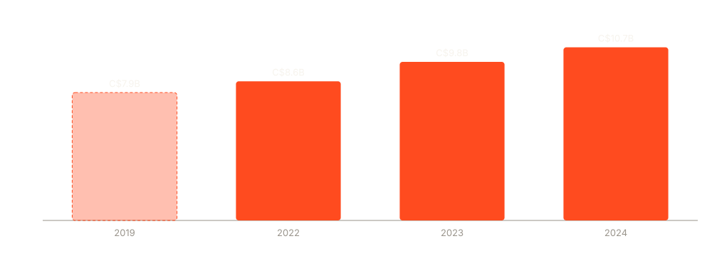
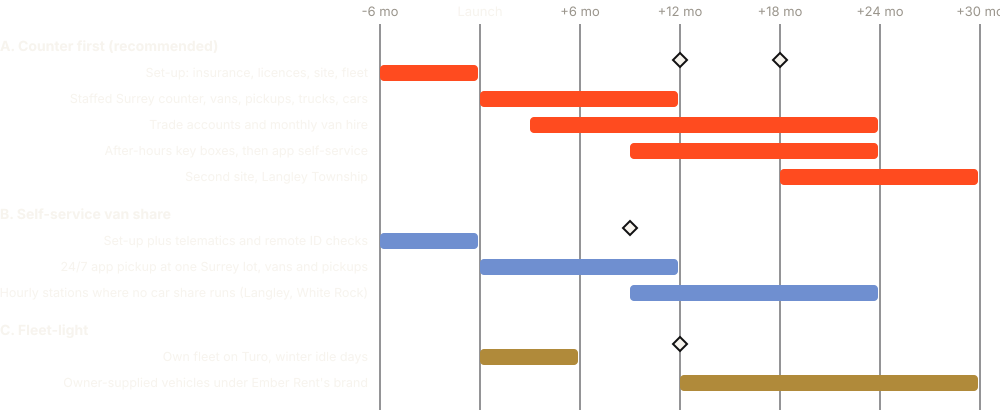

# Car sharing and rental plan

How Ember Rent competes with car sharing and app-based rental in Metro Vancouver, what similar businesses did, the roadmaps open to it, every point needed to run actual rentals, and the compliance, startup costs, SWOT and AI operations specific to this line. Retrieved 23 November 2026. Prices exclude GST and PST unless noted. The main business plan is in the first tab.

## 1. The answer

**Compete with a staffed Surrey counter for vans, pickups and light trucks first, with trade accounts and after-hours key boxes, and add app self-service only once damage and no-show costs are known. Do not try to out-price car sharing on short car trips. Fund the fleet so that a 15 to 20% fall in resale values does not force a sale.**

1. **Car sharing has reached Surrey, but only for cars and only in the north.** Evo opened one-way zones at Surrey Central and Guildford on 20 July 2026 ([BCAA](https://www.bcaa.com/media-centre/2026/evo-car-share-expands-to-surrey)). Modo lists Surrey and is the City of Surrey's car share provider ([Modo](https://www.modo.coop/for-municipalities)). No car share operator lists Langley, White Rock or Delta beyond the Tsawwassen ferry terminal.
2. **Car share is cheapest for short car trips and Ember Rent should not fight it there.** A 3-hour, 30 km car trip costs C$28.50 at Modo and C$55.82 at Evo (section 2.2). A counter rental with a one-day minimum cannot match that.
3. **Vans and trucks are where the field is thin.** Modo is the only car share with pickups and cargo vans, round trip only, from fixed spots. Evo has none. U-Haul, Home Depot and Enterprise Truck run counters. Turo hosts set their own prices.
4. **Similar businesses failed on money, not demand.** Fluid Truck, Kyte, Getaround's US arm, HyreCar and Virtuo all closed between 2023 and 2025 after debt-funded growth, unpaid damage claims or expansion before markets were cash-positive (section 3).
5. **The industry is growing but prices are falling back.** Canadian automotive equipment rental and leasing revenue reached C$10.7 billion in 2024, up 4.3%, while passenger rental prices fell 11.5% in 2024 and stayed 29.8% above 2019 ([StatCan](https://www150.statcan.gc.ca/n1/daily-quotidien/260309/dq260309b-eng.htm)). Plan on today's rates, not the 2022 peak.

## 2. Competitors

### 2.1 Who operates in Metro Vancouver

| Operator | Model | Fleet (date) | Surrey, Delta, Langley, White Rock | Vans and pickups | Status and source |
|---|---|---|---|---|---|
| Evo (BCAA) | One-way within a home zone, plus round-trip Evo Return | 2,500, all hybrid or EV (July 2026) | Surrey Central and Guildford one-way since 20 July 2026, Evo Return at King George SkyTrain. Not Delta, Langley or White Rock | None | Operating ([BCAA](https://www.bcaa.com/media-centre/2026/evo-car-share-expands-to-surrey), [rates](https://evo.ca/rates)) |
| Modo (co-op) | Round trip from fixed spots | About 1,000, 35,000 members (2025) | Surrey listed, Tsawwassen ferry terminal. Not Langley or White Rock | Pickups, minivans, passenger vans, Ram ProMaster cargo vans | Operating ([plans](https://www.modo.coop/plans), [CEO letter, January 2026](http://www.modo.coop/blog/stewardship-through-change-a-reflection-from-modos-ceo)) |
| Turo | Peer to peer, host sets price | Vancouver listings up 73% year on year (March 2026), count not published | Hosts list anywhere, including Surrey | Whatever hosts list | Operating ([Turo release, April 2026](https://www.newswire.ca/news-releases/canadian-car-owners-are-turning-idle-vehicles-into-extra-income-ahead-of-this-summer-s-global-soccer-surge-893356275.html)). See the business plan, section 4.3 |
| U-Haul, including Truck Share 24/7 | Counter and app self-pickup with remote ID check and lockbox | 23,000+ locations offering Truck Share (February 2026) | Several Surrey sites, for example 13425 King George Blvd | 8 ft pickup, 9 ft cargo van, trucks | Operating ([U-Haul](https://www.uhaul.com/Tips/Loading/What-Is-U-Haul-Truck-Share-247-27466)) |
| Home Depot | Store counter, round trip | Not published | Three Surrey stores, which of them rent vehicles not confirmed | Cargo vans, pickup | Operating ([Home Depot](https://www.homedepot.ca/en/home/tool-and-vehicle-rental.html)) |
| KINTO Share (Toyota) | Weekly rentals for ride-hail and delivery drivers only | 55 vehicles, from 30 at launch in 2024 | Four Metro Vancouver Toyota dealers | None | Operating ([KINTO](https://www.kinto-mobility.com/services/kinto-share)) |
| Uber Rent | Books other firms' cars (Sixt, Dollar, Thrifty) | No own fleet | Vancouver and Surrey | Partners' fleets | Operating ([Uber](https://www.uber.com/ca/en/r/cities/car-rentals/vancouver-bc-ca)) |
| Zipcar | Round trip | About 80 vehicles at exit | | | Left BC 1 May 2020, citing BC insurance rules ([CBC](https://www.cbc.ca/news/canada/british-columbia/zipcar-to-stop-operations-in-b-c-may-1-1.5540191)) |
| Car2Go, Share Now | One way | | | | Left North America 29 February 2020 ([CBC](https://www.cbc.ca/news/canada/british-columbia/car2go-share-now-shutting-down-1.5401113)) |
| Communauto, Enterprise CarShare | Round trip and one way | | Not in BC | | Communauto runs in Quebec, Ontario, Alberta and Halifax. Enterprise CarShare in Toronto only ([Enterprise CarShare](https://www.enterprisecarshare.ca/ca/en/locations.html)) |

The majors' counters (Enterprise, Hertz, Avis, Budget, Penske and others) are counted in the business plan, section 4.

### 2.2 What a trip costs

Arithmetic and assumptions:
- Members who already hold an account. One-time fees are left out: Evo C$35 registration, Modo C$500 refundable share or C$6 a month.
- Evo bills the cheapest of its minute, hour and day rates, plus a C$1.85 trip fee. Gas, insurance, parking and kilometres are included. PVRT of C$1.50 applies from 8 hours ([Evo](https://evo.ca/rates)).
- Modo charges by the hour plus C$0.35 a km plus a C$3 fee per trip for gas cars. Whole-day bookings get the Day Tripper rate (C$100 for cars, including km). Modo does not state whether the C$3 fee applies to Day Tripper bookings. It is added here ([Modo](https://www.modo.coop/plans)).
- Home Depot: the national price page's large cargo van 4-hour rate, C$94.00 with unlimited kilometres (business plan, section 4.2). The Surrey store is not confirmed, and the Toronto store's own page listed C$99.95. The renter must carry their own non-owned vehicle liability insurance.
- U-Haul: the Surrey in-town quote for 3 December 2026, C$19.95 plus C$0.99 a km plus a C$1 environmental fee, so C$60.55 for 40 km (business plan, section 4.2). Rates vary by store and date. Turo prices are set by hosts.

**Damage exposure changes the comparison.** Evo charges a C$250 damage fee, or up to C$750 if damage is not reported ([Evo FAQ](https://evo.ca/faq)). Its business FAQ says up to C$1,000. Modo charges up to C$1,000, or C$2,500 for new members or after a large loss, and credit card collision cover does not apply to its trucks or cargo vans ([Modo](https://www.modo.coop/faqs/what-is-modos-damage-fee)).

### 2.3 Where Ember Rent can win

| Need | Who serves it now | Ember Rent's angle |
|---|---|---|
| Car for 1 to 4 hours, north Surrey | Evo, Modo | Do not compete. Car share is cheaper and closer |
| Car for a day or week, south of the Fraser | Majors' counters, Turo | All-in price, good, better, best classes, local pickup |
| Van or pickup for a job, Langley, White Rock, south Surrey | U-Haul, Home Depot, Enterprise Truck, Turo | No car share covers these areas. Hourly and half-day van hire with key boxes, trade accounts |
| Truck under 5,000 kg for a move or delivery | U-Haul, Penske, Enterprise Truck | Newer trucks, clear all-in price, account billing |
| Van for a week or a month for a trade or delivery business | Few local offers | Monthly work vans, the niche Kingbee Vans grew on (section 3) |

## 3. What similar businesses did

### 3.1 Outcomes

| Company | Model | Peak scale | Outcome | Stated reason |
|---|---|---|---|---|
| Fluid Truck (Denver) | App van and truck sharing, 24/7 keyless. About 3,500 of its 5,500 vehicles were owned by outside investors | 60 markets in 3 years | Chapter 11 October 2024, assets sold to Kingbee Vans December 2024 | Growth outran its controls, a C$15M-scale financing line lost when used-van values fell, mismanaged insurance claims ([TechCrunch](https://techcrunch.com/2024/10/18/fluid-truck-files-for-chapter-11-bankruptcy-and-pursues-sale-after-leadership-shakeup), [BusinessDen](https://businessden.com/2024/10/22/fluid-truck-bankrupt-after-ambitious-growth-strategy-led-to-eight-figure-losses)) |
| Kyte (San Francisco) | Own fleet delivered to the door | 14 US markets, 2,000+ vehicles | Cut to 2 markets October 2024, shut August 2025 | Behind on loans, lender repossessed the fleet ([TechCrunch](https://techcrunch.com/2025/08/15/kyte-which-billed-itself-as-the-best-competitor-to-hertz-shuts-down)) |
| Getaround (US) | Peer to peer with keyless hardware | Bought HyreCar 2023 | US wound down February 2025, Europe sold April 2026 | Lack of liquidity, unpaid owner damage claims ([Getaround](https://www.getaround.com/blog/winding-down-our-carsharing-service-in-the-u-s)) |
| HyreCar | Peer to peer for gig drivers | Revenue US$35.7M (2021), net loss US$26.0M | Chapter 11 February 2023 | Insurance costs, legal costs, a fleet joint venture liquidated ([SEC](https://www.sec.gov/Archives/edgar/data/1713832/000143774922006291/hyre20211130_10k.htm)) |
| Virtuo (Paris) | App-only rentals with delivery | 4,000 vehicles (2021) | Liquidated 2025 | Price competition, rising maintenance, insurance and logistics costs, funding withdrawn ([FrenchWeb](https://www.frenchweb.fr/virtuo-en-redressement-judiciaire-la-startup-de-location-de-voitures-cherche-un-repreneur/451968)) |
| Car2Go, Share Now | One-way, automaker owned | | Left North America February 2020 | Rising costs, competition from ride-hailing ([Reuters](https://www.reuters.com/article/business/daimler-bmw-exiting-north-american-car-sharing-market-cutting-in-europe-idUSKBN1YM2BM)) |
| Zipcar | Round trip membership | 10,000+ vehicles (2013) | Left BC 2020, left the UK January 2026, still in the US | BC insurance rules. UK: rising costs, fewer trips, costly EVs ([BBC](https://www.bbc.com/news/articles/cp8zv1gr0z9o)) |
| Turo | Peer to peer | Gross bookings US$2.41B, 24.4M days booked (2023) | Operating. IPO withdrawn February 2025 | Growth slowed from 59% to 8% ([S-1/A](https://www.sec.gov/Archives/edgar/data/1514587/000162828024047889/turoinc-sx1a12.htm)) |
| Communauto (Quebec) | Round trip plus one-way FLEX | From 3 cars in 1994 to 7,416 vehicles (May 2026) | Growing | Grows through parking agreements with cities ([Communauto](https://communauto.com/2025-another-season-of-expansion-for-communauto-in-montreal-and-longueuil)) |
| Modo (Vancouver) | Member-owned co-op, round trip | From 2 cars in 1997 to about 1,000 | Operating | Membership up 7% in a year (October 2025) |
| U-Haul Truck Share 24/7 | Self-service app pickup | 23,000+ locations | Operating. Self-moving rental revenue US$3.81B in fiscal 2026 | A decade of development before launch in 2017 ([U-Haul](https://www.uhaul.com/Articles/About/U-Haul-Truck-Share-247-Disrupts-The-Self-Move-Industry-12021)) |
| Kingbee Vans (Utah) | Upfitted work vans on flexible terms, delivered | About 1,700 vans (2024). Revenue US$2.6M (2021) to US$18.8M (2022) | Growing. Entered Canada April 2024, bought Fluid Truck | Started from the founders' upfitting shop with 100 vans ([Utah Business](https://www.utahbusiness.com/entrepreneurship/2024/08/01/scott-haslam-founded-kingbee-work-ready-vans)) |
| Discount Car and Truck Rentals (Ontario) | Independent counter rental, insurance replacement | 300+ locations from one Hamilton site in 1980 | Bought by Enterprise, September 2020 ([Enterprise](https://www.enterprisemobility.com/en/news/press-releases/2020/09/enterprise-holdings-closes-acquisition-of-discount-car-and-truck-rentals.html)) | |

Fluid Truck's lost financing line was US$15M, not Canadian dollars. Evo's financials, Communauto's profit, Penske's rental metrics and Fluid Truck's revenue per vehicle were not found.

### 3.2 Lessons for one Surrey site

1. **Match vehicle loans to depreciation and keep cash.** Kyte's lender took the fleet, Fluid lost a financing line when van values fell, HyreCar's fleet venture was liquidated. Test the budget against a 15 to 20% fall in resale values.
2. **Open a second site only after the first is cash-positive.** Fluid went to 60 markets in 3 years. Kyte cut 14 markets to 2 because 12 had no free cash flow.
3. **Damage and insurance are the cost that kills.** Fluid mismanaged claims, Getaround could not pay owners' claims, Zipcar left BC over insurance. Price damage waivers from real claim costs and settle cover before launch (section 5.2).
4. **Keep outside owners' money separate.** Fluid's investor-owned vehicle program ended in lawsuits and about US$12M owed to owners. This matters for the fleet-light roadmap (section 4).
5. **Commercial rental follows the building and freight cycle.** Ryder's rental utilisation fell from 75% to 70% in 2024 and stayed at 70% in 2025 ([Ryder 10-K](https://d18rn0p25nwr6d.cloudfront.net/CIK-0000085961/f0f4eb0f-0f02-410e-b103-70a87976d54c.pdf)).
6. **Self-service works once the checks are in place.** U-Haul spent a decade building remote ID checks, lockboxes and photo check-in before it scaled. A small operator can buy these as services (section 5.4).
7. **Charge for delivery separately.** Kyte and Virtuo carried a driver on every handover.
8. **Work vans by the month are a proven niche.** Kingbee grew from 100 vans to about 1,700 in three years serving trades and delivery fleets.
9. **Partner for parking and demand.** Communauto grew through city parking agreements. Modo is the City of Surrey's car share provider.

### 3.3 Industry numbers

StatCan later revised 2022 and 2023 without restating the dollar totals in its 2024 release. In 2023, 55.7% of industry sales were to businesses ([StatCan](https://www150.statcan.gc.ca/n1/daily-quotidien/250117/dq250117e-eng.htm)).

Sources: Hertz FY2023 and FY2025 10-K filings ([2023](https://www.sec.gov/Archives/edgar/data/47129/000165785324000022/htz-20231231.htm), [2025](https://www.sec.gov/Archives/edgar/data/1657853/000165785326000008/htz-20251231.htm)). Avis Americas revenue per day was US$70.94 in 2024 and US$68.80 in 2025, with utilisation of 68.7% and 69.9% ([Avis, 18 February 2026](https://www.avisbudgetgroup.com/content/dam/avisbudgetgroup/press_pdf/2025/Press%20Release%20F25%20-%20Final%20-%202.18.2026.pdf)). Earlier Avis years could not be read from the source and are left out. These are airport-heavy car fleets. They set a ceiling for Ember Rent's utilisation target (U*), not a forecast.

Canadian car sharing grew from 26,878 members in 2007 to 642,472 in January 2018, with 8,052 vehicles, about 80 members per vehicle ([TSRC](https://escholarship.org/content/qt9jh432pm/qt9jh432pm_noSplash_52e573489ebfdc635da0ba59ac48db87.pdf)).

## 4. Roadmaps

The months are a plan, not a forecast. Each phase starts only when its gate is passed.

| | A. Counter first (recommended) | B. Self-service van share | C. Fleet-light |
|---|---|---|---|
| What it is | Staffed Surrey counter for vans, pickups, light trucks and cars, then trade accounts, after-hours key boxes and app self-service | 24/7 app pickup from one Surrey lot, then hourly stations in Langley and White Rock, where no car share runs | Ember Rent's own vehicles on Turo in the winter trough, then owners' vehicles rented under Ember Rent's brand |
| Model it copies | Discount Car and Truck, Kingbee Vans | U-Haul Truck Share 24/7, Fluid Truck, Modo's vans | Turo co-hosts, Turo's US passive-income program |
| Capital | Highest at launch: fleet, site, counter | Fleet plus telematics, keyless and remote ID per vehicle (section 5.4) | Lowest |
| Staff | Counter from day one | Fewest, but cleaning, delivery and damage still need people (business plan, section 4.4) | Turnover and cleaning |
| Main risk | Fixed costs before utilisation builds | Damage, fraud and no-shows with no one at handover, Fluid Truck's failure | Insurance and tax treatment unanswered, Fluid's owner-money problems |
| Gate | Break-even utilisation held 3 months, then Surrey cash-positive 6 months before a second site | Damage and no-show costs within budget by month 9 | ICBC, PVRT and Surrey licence answers in writing (business plan, section 4.3) |

**Why A.** It earns trust with trade customers first, tests demand with the least technology, and turns into B one feature at a time: key boxes, then app pickup, then stations. C is an add-on for idle winter days, not a way to launch.

## 5. Running actual rentals

Every point the first rental needs, in the order a booking runs. Items already settled in the business plan are referenced, not repeated. Open legal points are marked **Ask a lawyer** or **Ask a broker**.

### 5.1 Before the first rental

| Item | Requirement | Source |
|---|---|---|
| Surrey business licence and zoning | Automobile and Truck Rental licence, zone CHI first | Business plan, R7 |
| ICBC rental cover | U-Drive classes 008 and 018, Fleetplan threshold | Business plan, R5 |
| PVRT and PST registration | Collected on every rental | Business plan, R4 |
| **Restricted insurance agency licence** | From 1 January 2027 a vehicle rental agency selling insurance to renters needs this licence. Applications open 4 January 2027, existing sellers must apply by 31 March 2027. Needs errors and omissions cover of C$1M per claim and C$2M aggregate, an insurer's authorisation and a trained designated representative. Unlicensed sales risk a C$50,000 fine. **Ask a lawyer** whether a damage waiver counts as insurance | [Insurance Council of BC](https://www.insurancecouncilofbc.com/ria/who-needs-licence), [McMillan, 3 November 2026](https://mcmillan.ca/insights/publications/bcs-restricted-insurance-licensing-framework-what-businesses-need-to-know) |
| NSC certificate | Only for vehicles over 5,000 kg, which the launch fleet avoids. C$200 fee, about 12 to 14 weeks | [CVSE](https://www.cvse.ca/national_safety_code/nsc_application.htm), business plan R6 |
| Vehicle documents | Vehicle licence or a copy in every vehicle (Motor Vehicle Act s.11). Keep a paper insurance card too, electronic copies were not confirmed | [BC Laws](https://www.bclaws.gov.bc.ca/civix/document/id/complete/statreg/96318_01) |
| Rental agreement reviewed | BC consumer protection rules (section 5.3) | **Ask a lawyer** |
| Booking and payments live | Software and card processor (section 5.4) | |

### 5.2 Who can rent

| Check | Practice | Source |
|---|---|---|
| Licence class | Class 5 or 7 drives every launch vehicle: two-axle cars, vans and trucks, trailers to 4,600 kg | [ICBC](https://icbc.com/assets/en/40I9m5k2Tqnf7aNs5kqPHj/drivers9.pdf) |
| New drivers (rules changed 19 October 2026) | Class 7 holders aged 25 and over no longer show an N sign or have a passenger limit. Under 25: N sign, one passenger plus family. All N drivers: zero alcohol and no devices. The agreement must bind renters to their licence restrictions | [ICBC](https://icbc.com/driver-licensing/new-drivers/graduated-licensing-program-changes) |
| Learner licences | Refused, as at Enterprise and Budget BC | [Budget BC](https://www.bcbudget.com/faq) |
| Visitors | Valid home licence for up to 6 months. An International Driving Permit only with the original | [ICBC](https://icbc.com/driver-licensing/moving-bc/moving-from-another-country) |
| Driving record | The driver downloads a free 5-year abstract from My ICBC and sends it, or signs form MV2680 naming Ember Rent. No real-time ICBC check for businesses was found | [ICBC](https://icbc.com/driver-licensing/getting-licensed/Your-driving-record) |
| ID and selfie check | Stripe Identity US$1.50 per check, first 50 free. Veriff from US$0.80 with a US$49 monthly minimum | [Stripe](https://stripe.com/identity), [Veriff](https://www.veriff.com/pricing) |
| Minimum age and young-driver fee | Enterprise: 21, C$20 a day under 25 on trucks, vans and pickups up to ¾ ton only. Budget BC: 19, C$25 a day under 25. National: C$35 a day for 21 to 24 | [Enterprise Surrey](https://www.enterprise.com/en/car-rental-locations/ca/bc/surrey-truck-rental-c45t.html), [Budget BC](https://www.bcbudget.com/faq) |

### 5.3 Agreement, fees and policies

**Rules that shape the agreement.**
- BC's unfair contract terms rules cover consumer contracts made from 31 March 2025. From 1 August 2026 consumer contracts cannot bar reviews, force arbitration or waive class actions ([Consumer Protection BC](https://www.consumerprotectionbc.ca/guidance-for-businesses-law-changes)).
- Online bookings are distance sales contracts. The customer must see the required details, be able to correct errors and accept or decline, and get terms they can print ([BPCPA](https://www.bclaws.gov.bc.ca/civix/document/id/complete/statreg/04002_04)).
- Disputes up to C$5,000 go to the Civil Resolution Tribunal ([CRT](https://civilresolutionbc.ca/blog/bc-legislature-expands-the-crts-small-claims-jurisdiction)).
- Privacy (BC PIPA): collect only what is reasonable, keep data used to decide on a renter for at least a year, then destroy it, and secure it ([OIPC](https://www.oipc.bc.ca/documents/guidancedocuments/1371)). Alberta's commissioner found photocopying renters' licences unreasonable, a guide for BC, not binding. Disclose GPS tracking in the agreement.

**Fees, benchmarked against published policies.**

| Fee | Market practice | Source |
|---|---|---|
| Late return | Enterprise: 29-minute grace, then hourly, a full day from 2.5 hours. Mr Rent A Car Surrey: 30-minute grace, a full day after 2 hours | [Enterprise](https://www.enterprise.ca/en/help/faqs/late-returns-policy.html), [Mr Rent A Car](https://www.mrrentacar.com/best-choice-for-car-rental-in-surrey) |
| Kilometres | Mr Rent A Car: 200 km a day for local renters, C$0.25 per km over. Access: 300 km a day. Streetride Surrey: unlimited in BC | [Access](https://www.accessrac.com/faq/), [Streetride](https://streetride.ca/) |
| Smoking and cleaning | Hertz Canada C$400 smoking. Mr Rent A Car C$500 minimum for smoking or pets. Access C$250 minimum cleaning | [Hertz](https://images.hertz.com/pdfs/ENGLISH-Hertz-Canada-Auto-Terms-and-Conditions.pdf) |
| EV charge | Avis and Budget: C$35 below 70% charge, another C$35 below 10% | [Budget](https://www.budget.ca/en/legal-documents/rental-terms) |
| Cancellation | Enterprise prepaid: C$65 more than 24 hours ahead, C$135 within 24 hours or no-show. Pay-later free | [Enterprise](https://www.enterprise.com/en/car-rental-faqs/canada-reservations/change-cancel-reservation.html) |
| Extra driver, towing | C$10 a day extra driver at Enterprise and Budget BC. Enterprise towing package C$25 a day | as above |
| Deposit | National: C$300 cars, C$500 vans and pickups, C$1,000 one-ton pickups. Sunnyside South Surrey: C$300 to 1,000 hold | [National](https://www.nationalcar.com/en/car-rental-locations/ca/bc/north-vancouver-y175.html), [Sunnyside](https://sunnysidestorage.ca/truck-rentals-surrey) |
| Damage waiver | Enterprise North Surrey C$32.99 to 79.99 a day. Sunnyside one-time C$18.95, C$300 deductible | [Enterprise](https://www.enterprise.ca/en/car-rental-locations/ca/bc/north-surrey-king-george-blvd-c413.html) |

**What the renter is covered for.** The vehicle's ICBC Basic gives C$200,000 third-party liability and accident benefits. Damage to the vehicle needs Ember Rent's own Collision cover or the waiver ([ICBC](https://icbc.com/insurance/products-coverage/basic-insurance)). Renters with ICBC's Rental Vehicle Policy (about C$10 a day, or included in RoadStar and Roadside Plus) get collision cover with a C$300 deductible on rentals of up to 30 days and C$300 a day, excluding commercial vehicles over 5,000 kg ([ICBC](https://www.icbc.com/assets/en/4bYpswFaIjYOKJO2cDlysF/autoplan-insurance-brochure.pdf)). **Ask a broker** how a renter-caused claim is recovered.

### 5.4 Handover, return and damage

1. **Pickup.** Licence and ID check (section 5.2), card pre-authorisation, a walk-around with timed photos on the app, signature on the agreement including the damage page.
2. **Return.** A joint walk-around with photos. After a Consumer Protection BC review, Budget undertook not to charge for damage the customer did not sign off at return, except after-hours drops or when the customer leaves before inspection ([CBC](https://www.cbc.ca/news/canada/british-columbia/budget-rent-a-car-may-have-engaged-in-deceptive-acts-consumer-watchdog-1.3471056)). Adopt the same rule.
3. **Damage charged after return must follow card rules.** Visa requires the renter's signature on the page that describes delayed charges, documents within 10 business days including 2 repair quotes, a statement that card payment is optional, 10 business days for the renter's own quote, a wait of 20 business days before charging and a charge within 90 days. Mastercard requires a separate transaction the renter authorises ([Visa rules](https://usa.visa.com/dam/VCOM/download/about-visa/visa-rules-public.pdf)).
4. **After hours.** Key boxes and app pickup (business plan, section 4.4) only once steps 1 to 3 run reliably at the counter.

**Stack, published prices (US$ unless stated).**

| Need | Options | Source |
|---|---|---|
| Rental software | Fleetwire US$34 a month (5 vehicles), US$89 (15). HQ, RentSyst, Booqable in business plan section 10.4. Wheelbase from US$350 | [Fleetwire](https://fleetwire.io/pricing), [Wheelbase](https://www.wheelbasepro.com/pricing) |
| Damage photos | Record360 quote only, a third-party review site lists US$195 a month | [Record360](https://record360.com/pricing) |
| Telematics | Geotab through a reseller US$17 to 28 per vehicle a month plus a US$85 device. Samsara list US$39 a month plus US$179, 3 to 5 year contracts | [Fleet Wolf](https://fleetwolf.com/content/geotab-vs-samsara.html) |
| Keyless | Smartcar from US$1.99 per vehicle a month on compatible models. INVERS CloudBoxx €635 plus €17.90 a month. Geotab keyless price not published | [Smartcar](https://smartcar.com/pricing), [fleetster](https://www.fleetster.net/fleet-hardware/invers-cloudboxx) |
| Payments (C$) | Stripe 2.9% + C$0.30 online, 2.7% + C$0.05 in person, C$15 per dispute. Card holds last 7 days online, up to 30 days for vehicle rental on request. Moneris 2.85% + C$0.30 online, terminal C$34.95 a month, 3-year contract | [Stripe](https://stripe.com/ca/pricing), [extended holds](https://docs.stripe.com/payments/extended-authorization), [Moneris](https://www.moneris.com/en/pricing) |

### 5.5 Fleet

| Item | What was found | Source |
|---|---|---|
| Financing | Ford Credit CommerciaLease excludes rental units. Element lists rental fleet financing. Foss National leases 2 to 5 years. Rates are by quote only | [Ford](https://www.ford.ca/finance/commercial-financing/commercialease), [Element](https://elementfleet.ca/manage/commercial-fleet-financing), [Foss](https://www.fossnational.com/en/fleet-rentals) |
| Holding period | Hertz sold its US rental cars after an average of about 18 months in 2025 and plans for 27 | [Hertz 10-K](https://www.sec.gov/Archives/edgar/data/47129/000165785326000008/htz-20251231.htm) |
| Weight limits | Ram ProMaster 3500 GVWR 4,241 kg and Ford Transit T-350HD cutaway up to 4,989 kg stay under 5,000 kg. Chevrolet Express 3500 cutaway up to 5,579 kg is over. The limit includes any trailer | [Ram](https://www.ramtruck.ca/documents/ramtruck/specifications/2019-ramtruck-promaster-specifications-en.pdf), [Ford](https://www.ford.ca/commercial-trucks/transit-chassis/models/transit-cutaway/), [Chevrolet](https://www.chevrolet.com/commercial/express/cutaway) |
| Inspections | No periodic CVIP inspection under 8,200 kg. Daily pre-trip inspection only for commercial vehicles over 5,000 kg | [BC Gov](https://www2.gov.bc.ca/gov/content/transportation/vehicle-safety-enforcement/services/vehicle-inspections-standards/vehicles) |
| Recalls | Check every VIN on the maker's recall lookup before each rental. No Canadian law bans renting a recalled vehicle, but renting one exposes Ember Rent to liability | [Transport Canada](https://tc.canada.ca/en/importance-having-recalled-vehicles-repaired) |
| Resale | OPENLANE (ADESA) Vancouver in Richmond runs a fleet and lease sale every Thursday. Discount, Budget and Enterprise consign there. Seller fee not published | [OPENLANE](https://www.openlane.ca/en/locations/vancouver) |

### 5.6 Hours and staff

| Item | What was found | Source |
|---|---|---|
| Competitor hours | Enterprise North Surrey: weekdays 8 to 5, weekends 9 to 4, no after-hours returns. Enterprise Truck Surrey: weekdays 8 to 5, Saturday 9 to 12. U-Haul King George: from 7 am daily, to 7 or 8 pm, 24-hour returns | [Enterprise](https://www.enterprise.ca/en/car-rental-locations/ca/bc/north-surrey-king-george-blvd-c413.html), [U-Haul](https://www.uhaul.com/Locations/Truck-Rentals-near-Surrey-BC-V3T2T8/846056) |
| Opening hours | Open from 7 am on weekdays, the trades' start, which Enterprise does not. 24-hour returns by key box from launch | Ember Rent proposal |
| Wages | BC minimum C$18.25 from 1 June 2026. Rental agents C$19 to 21 an hour in Langley and Burnaby, Ryder Delta C$29.50. Enterprise Surrey detailer C$19.50 | [BC Gov](https://www2.gov.bc.ca/gov/content/employment-business/employment-standards-advice/employment-standards/wages/minimum-wage), [Indeed](https://ca.indeed.com/career/rental-agent/salaries/Vancouver--BC) |
| Roles | Local postings combine counter, video check-in inspections, cleaning and customer pickup in one rental agent job | [Talent.com](https://ca.talent.com/view?id=566738571638219775) |

### 5.7 Measures

The business plan's KPIs (section 12) apply. Add for car sharing and self-service:
- **Trips per vehicle per week** by class, and **hours on rent per trip**, to see whether hourly van hire is used.
- **Damage cost per rental day** and **share of damage recovered**, against the waiver revenue.
- **No-show and late-return rate**, the measure that gates roadmap B.
- **Share of bookings from Langley, White Rock and south Surrey**, the areas no car share serves.

## 6. Compliance for car sharing and self-service

The full register is in the business plan, section 14. These are the points that change when Ember Rent adds hourly, app-based or unattended rentals (roadmaps B and C).

| Point | What it means for self-service | Source |
|---|---|---|
| Licence inspection and record book, Motor Vehicle Act s.56 | Before each rental the business must inspect the renter's licence and take a signed record-book entry with name, address and licence number. Unattended app pickup needs a legal opinion on whether a remote check satisfies "inspection". U-Haul's Truck Share 24/7 uses a live remote agent to verify each renter. **Ask a lawyer** before any unattended pickup | [MVA](https://www.bclaws.gov.bc.ca/civix/document/id/complete/statreg/96318_01), [U-Haul](https://www.uhaul.com/Tips/Loading/What-Is-U-Haul-Truck-Share-247-27466) |
| ICBC car-share rating (class 018) | Only for an operator renting to members by the hour or day, mostly local residents, with a signed application, restrictive driving-record criteria, a yearly re-check and a membership fee, and not generally to tourists. An open app product stays U-Drive (class 008 or 018) | [ICBC tariff](https://www.icbc.com/assets/en/6PyY5DEcoIT7z2ujjlwb3d/basic-tariff.pdf) |
| PVRT on short trips | PVRT applies from 8 hours, as Evo and Modo show on their rate pages. Hourly trips under 8 hours carry none | [Evo](https://evo.ca/rates), [Modo](https://www.modo.coop/plans) |
| Location data | Telematics location is personal information under BC PIPA. Tell renters in the agreement what is tracked, why and for how long. No commissioner guidance specific to customer GPS was found | Business plan 14.2 |
| Automated screening | No AI refusal without a person. Human Rights Code risk from proxies, and Bill C-36 would add disclosure and review rights | Business plan 14.1 and 14.2 |
| Damage charges after return | Self-service has no joint walk-around, so Budget's undertaking on unsigned damage and the card networks' delayed-charge rules bite harder. Timed app photos at pickup and return are the evidence | Section 5.4 |
| Driverless delivery | Illegal in BC (MVA Part 12.1). Delivery and repositioning stay human-driven | Business plan 14.2 |
| Owner-supplied vehicles (roadmap C) | ICBC rating, owner declaration, PVRT and licence answers in writing first (business plan 4.3, R15) | Business plan 4.3 |

## 7. Startup costs by roadmap

The base costs are in the business plan, section 15. Roadmaps B and C change these lines. Unit prices are sourced, fleet counts are **ASSUMPTION**.

| Line | A. Counter first | B. Self-service van share | C. Fleet-light | Unit price and source |
|---|---|---|---|---|
| Staffed counter and opening hours | Yes | Minimal, remote verification instead | Turnover only | Wages, section 5.6 |
| Telematics per vehicle | Optional at launch | Required | Required on own vehicles | Geotab via reseller US$17 to 28 a month plus US$100 hardware ([Fleet Wolf](https://fleetwolf.com/content/geotab-vs-samsara.html)) |
| Keyless per vehicle | Key boxes after hours | Required | Turo Go where compatible | Smartcar from US$1.99 a month on compatible models. INVERS CloudBoxx €635 plus €17.90 a month ([fleetster](https://www.fleetster.net/fleet-hardware/invers-cloudboxx)) |
| Remote ID and selfie checks | At the counter | Every booking | Turo runs them | Stripe Identity US$1.50 a check ([Stripe](https://stripe.com/identity)) |
| Damage photo app | Optional | Required | Turo requires host photos | Record360, a third-party review site lists US$195 a month |
| Key lockers at a hub | Optional | Required | Optional | KeyNest 9-slot C$1,949 plus C$149 a month, Keycafe US$2,750 plus US$59 to 175 a month (business plan 4.4) |
| Fleet capital | Highest | Same vehicles, fewer staff | Lowest | Business plan 11.6, 15.1 |

**Worked example, roadmap B, 10 vans. ASSUMPTION.**
- Telematics: 10 × (US$28 a month + US$100 once) = US$280 a month and US$1,000 once.
- Keyless (INVERS CloudBoxx): 10 × €635 = €6,350 once, plus 10 × €17.90 = €179 a month.
- ID checks: 300 bookings a month × US$1.50 = US$450 a month.
- Damage photo app: US$195 a month.
- Monthly total: US$925 plus €179. One-time: US$1,000 plus €6,350.

## 8. SWOT for the car sharing and self-service line

| Strengths | Weaknesses |
|---|---|
| Vans and pickups by the hour, which only Modo offers today, and only round trip from fixed spots (section 2) | No membership base. Evo has 2,500 vehicles and Modo about 1,000 (section 2.1) |
| Langley, White Rock and south Surrey have no car share (section 2.1) | Unattended pickup needs a legal answer on MVA s.56 first (section 6) |
| An AI layer can run bookings around the clock at a cost per month below one agent's wages (business plan 17.4) | Self-service carries the damage and fraud costs that ended Fluid Truck and Getaround (section 3) |

| Opportunities | Threats |
|---|---|
| Construction and infrastructure through 2031 need short van hires near sites (business plan 16.3) | Evo may expand south once its Surrey usage proves out (section 2.1) |
| Surrey's truck route and closure data, live in the trip planner, can be built into booking and dispatch | Synthetic-ID vehicle fraud up 72% nationally in 2025 (business plan 16.4) |
| ICBC car-share rating could lower insurance cost if a membership model fits (section 6) | A Hertz-style backlash if automated damage billing errs (business plan 16.4) |
| Turo's customer base for idle days (business plan 4.3) | Turo can close accounts or change shares (R14) |

**What follows.** Start self-service with existing trade customers who have passed a counter rental, so identity and conduct are known, before opening it to the public.

## 9. AI operations for self-service

Self-service is where continuous AI work matters most, because no one stands at the counter. The model roles, costs and controls are in the business plan, section 17. Specific to this line:

| Task at any hour | Agent work | Person |
|---|---|---|
| Booking request at 2 am | Sol checks identity results, payment signals and account history, and holds a vehicle | A remote verifier confirms the licence by video where the law requires it (section 6) |
| Vehicle not returned | Sol reads telematics, messages the renter, re-plans the next booking | Owner decides on recovery or police report |
| Damage reported in photos | Opus builds the evidence file, Astra checks it | Owner approves any charge |
| Road closure on a renter's route | Sol reads Surrey closures and DriveBC events, as the trip planner does, and messages the renter | None needed for a notice |
| Usage pattern | Fable reviews trips per vehicle, hours on rent and no-shows weekly against the roadmap B gate (section 4) | Owner decides to extend or stop roadmap B |

## 10. Open questions

1. Does a damage waiver need the restricted insurance agency licence from 1 January 2027? **Ask a lawyer.**
2. How does a fleet's own ICBC or private policy recover renter-caused damage? **Ask a broker.**
3. Home Depot's BC van prices and which Surrey stores rent vehicles. Call the stores.
4. Modo's vehicle count in Surrey, and whether its vans are parked south of the Fraser. Check the Modo app map.
5. U-Haul's Surrey per-km rate and whether each Surrey site offers Truck Share 24/7. Get quotes.
6. Turo van and pickup supply and prices in Surrey. Search the Turo app for set dates.
7. Is a written trip-inspection report needed for a vehicle rented for a single trip (MVAR s.37.61)? Only matters above 5,000 kg.
